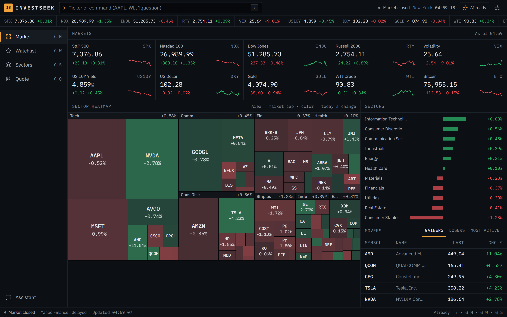
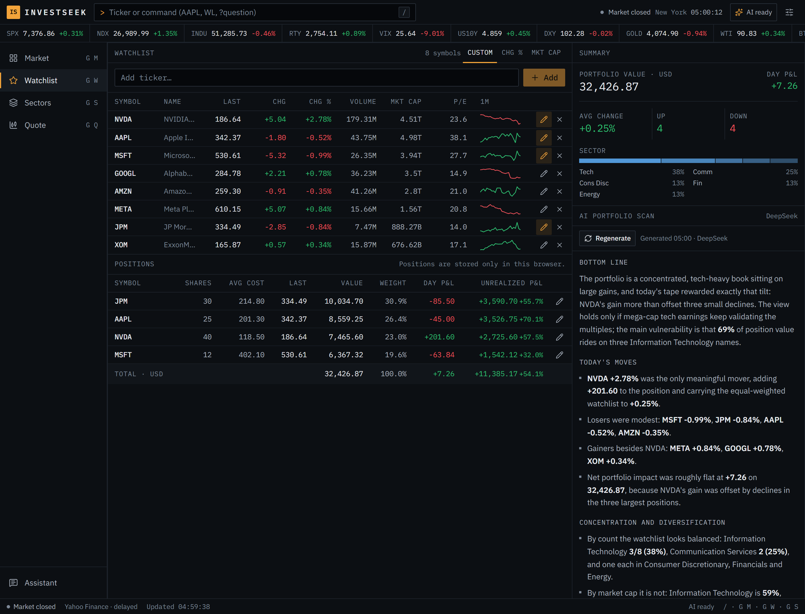
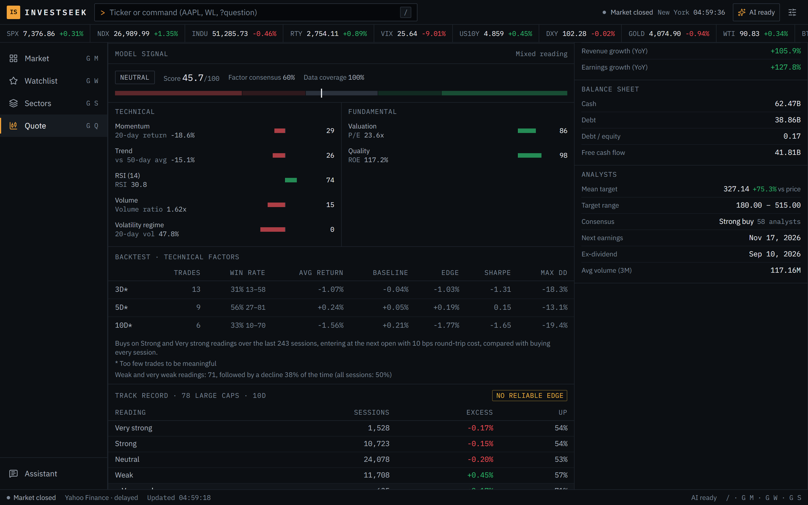
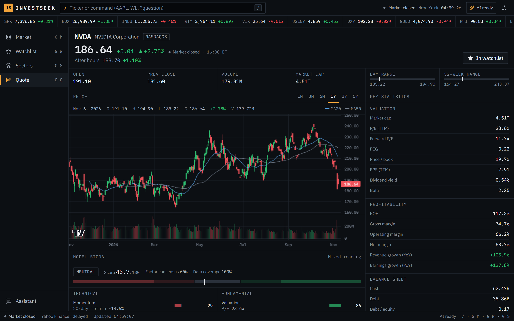
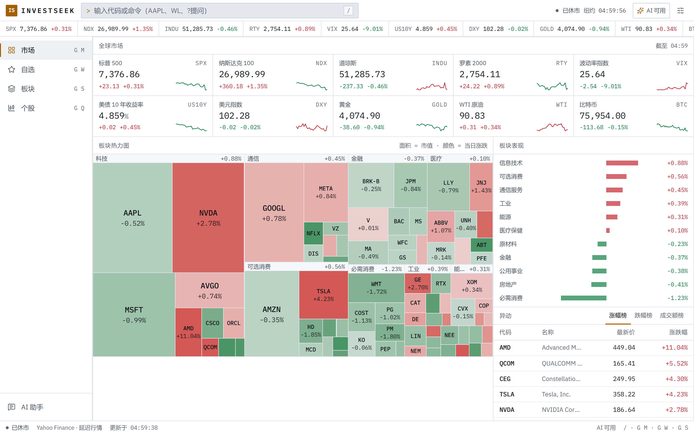
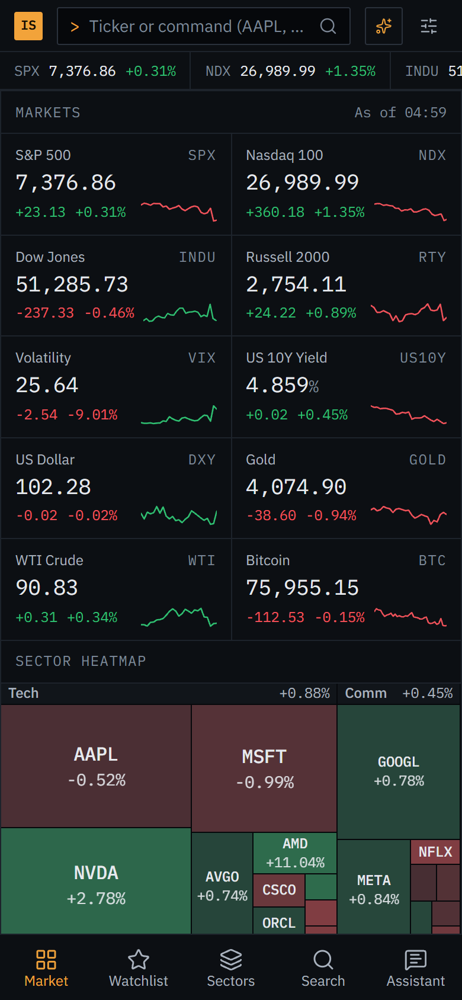

# InvestSeek

**A terminal-style market workstation for one investor.** Live quotes, a market-cap heatmap, a portfolio tracker, a quant score that publishes its own track record, and AI research notes grounded in server-side data. English and 中文.

[](https://github.com/DestRoyOvO/invest-app/actions/workflows/ci.yml)


[](LICENSE)

[中文说明](README.zh-CN.md)



## Why

Most personal dashboards either show numbers without context or wrap a chatbot around a stock price. InvestSeek borrows the habits of a professional terminal instead: dense, keyboard-first, every number sourced, and every model output shown with the evidence and limits behind it, including when the evidence says the model does not work.

## Highlights

- **It tests its own signal and shows you the result.** An offline evaluation over 78 large caps and two and a half years found that the technical score has no reliable forward edge, and that weak readings were followed by above-average returns. The app now describes the score as a reading of the current setup, prints the track record under every score, and gives the AI the same facts. See [what the evaluation found](#what-the-evaluation-found).
- **Portfolio-aware AI.** Enter shares and average cost, and the AI portfolio scan weighs concentration, risk and today's P&L by position value rather than by ticker count.
- **Grounded AI with fenced inputs.** Prompts are assembled on the server from server-side data only. Headlines and article text are fenced off as untrusted data, and requests are rate limited, budgeted and cancellable.
- **Production habits.** A typed client-server contract, tiered caching with in-flight de-duplication, security headers and a CSP, SSRF-safe article fetching, more than 400 unit tests and CI.

<p>
  
  
</p>

## Features

**Market overview**
- Board of indices, rates, FX, commodities and crypto with one-month sparklines.
- Sector heatmap of 78 large US stocks: squarified treemap sized by market cap, colored by today's move.
- Sector performance, movers (gainers, losers, most active by dollar volume) and market headlines.

**Quote page**
- Candlestick chart with volume and 20/50-period moving averages over six ranges ([lightweight-charts](https://github.com/tradingview/lightweight-charts)).
- Key statistics grouped by valuation, profitability, balance sheet and analyst consensus, pre- and after-hours prices, and a company profile.
- News scored for relevance and labelled as company, industry or macro context.

**Watchlist and portfolio**
- Watchlist with sparklines, sorting and sector mix, stored in the browser: no account, no tracking.
- Positions with shares and average cost, showing value, weight, day P&L and unrealized P&L per position and in total.
- An AI portfolio scan that reads your positions and watchlist together.

**A quant score you can audit**
- Seven rule-based factors (momentum, trend, RSI, volume, valuation, quality, volatility regime), each shown with its raw input. Missing data is marked instead of silently scored as neutral.
- The composite is shown as a reading (very strong, strong, neutral, weak, very weak) with factor consensus and data coverage, never as a buy or sell call.
- A per-stock, technical-only backtest over about 250 sessions: next-open entries, trading costs, trade counts, Wilson intervals and a buy-every-session baseline.
- A universe-level track record from `npm run evaluate`, shown under the score: forward returns by reading against the base rate, plus the cross-sectional rank IC. A unit test fails when the model's weights or thresholds change without re-running it.
- Method and limitations: [docs/signal-model.md](docs/signal-model.md). Latest evaluation: [docs/evaluation.md](docs/evaluation.md).

**AI research notes (DeepSeek)**
- Notes for a stock, a sector, your portfolio, the market or a single headline, streamed and cancellable. An answer cut off by the length limit is flagged as such.
- The prompt context is built on the server from server-side data (quotes, statistics, technicals, the score and its track record, positions, headlines), never from free text the browser sends. Third-party text is fenced off as untrusted data.
- A research assistant that knows which page you are on.

**Terminal experience**
- Command bar (`/` or `Ctrl K`): type a ticker, `WL`, a sector name, or `?your question`.
- Keyboard shortcuts: `g m` market, `g w` watchlist, `g s` sectors, `g q` last quote.
- Dark and light themes, green-up or red-up price colors, English and Chinese.
- Responsive down to phone width, with a bottom tab bar.



<p>
  
  
</p>

## What the evaluation found

`npm run evaluate` recomputes the technical score for every session of 78 large US stocks (signals from 2024-04-30 to 2026-11-06), enters at the next open and measures returns before costs. The numbers below are from November 2026; [docs/evaluation.md](docs/evaluation.md) always has the latest run.

| Horizon | Rank IC (t) | Very strong: excess return | Very weak: excess return |
|---|---|---|---|
| 5 sessions | −0.025 (−1.44) | −0.16% | +1.55% |
| 10 sessions | −0.044 (−1.69) | −0.17% | +2.17% |
| 20 sessions | −0.026 (−0.81) | −1.02% | +2.07% |

The relationship is negative at every horizon and in both halves of the period, but never reliable (|t| < 2). It also runs opposite to a trend-following story, which fits the short-term reversal effect documented for large caps. The weights were not re-fitted to this one period, since that would only move the overfitting somewhere else. The product changed instead: neutral wording, a visible track record, and an AI that is told the same thing.

## Architecture

```
Browser (Next.js App Router, React 19, SWR)
   │  typed contract: types/api.ts
   ▼
Route handlers  app/api/**
   ├─ market, quotes, sparklines, search, news, stock, chart, signal
   │     └─ lib/server/yahoo.ts          one shared client · 8 s timeouts · per-symbol quote cache
   │        lib/server/cache.ts          TTL cache · in-flight de-duplication · stale-on-error
   │        lib/server/news.ts           multi-query search · relevance scoring · de-duplication
   │        lib/signal.ts                pure, tested signal engine + backtest
   │        lib/signal-evaluation.json   universe track record from scripts/evaluate-signal.ts
   └─ ai/analyze, ai/chat, auth/*
         └─ request guard → session check → rate limit + daily budget → zod schema
            → lib/server/ai-context.ts (server data only) → DeepSeek stream (cancel on disconnect)
```

Design decisions worth a look:
- **Caching tiers instead of hammering an unofficial API.** Quotes are cached 15 s while a session trades and 5 min otherwise, daily bars 10 min, fundamentals 6 h, news 10 min. Concurrent identical requests share one upstream call, and a failed refresh serves the last good value.
- **One contract for client and server.** `types/api.ts` defines every response. Numbers stay raw (no pre-formatted strings) and are formatted on the client with `Intl` in the user's language.
- **Security by default.** AI endpoints require a password session in production, are rate limited with a daily budget, reject cross-site requests and validate every body. Public market endpoints are rate limited per client. Article fetching for news analysis uses a host allowlist, blocks private and loopback addresses, re-checks redirects and caps time and size. Security headers and a CSP are set in `next.config.ts`.
- **Honest UI states.** Loading, empty, stale and error states are distinct. Unknown tickers show "not found" instead of an endless skeleton, and failed refreshes keep the last data on screen.

## Getting started

Requirements: Node.js 20.9 or newer (22 recommended). A DeepSeek API key is optional; everything except the AI features works without it.

```bash
git clone https://github.com/DestRoyOvO/invest-app.git
cd invest-app
npm install
cp .env.example .env.local   # then add DEEPSEEK_API_KEY
npm run dev                  # http://127.0.0.1:3000
```

| Variable | Required | Purpose |
|---|---|---|
| `DEEPSEEK_API_KEY` | for AI | DeepSeek API key |
| `DEEPSEEK_MODEL` | no | Model override, default `deepseek-chat` |
| `ACCESS_PASSWORD` | for AI in production | Password that unlocks AI features. Without it AI stays off in production; in development it is open on localhost |
| `SESSION_SECRET` | with a password | 32+ random characters used to sign the session cookie |
| `AI_DAILY_LIMIT` | no | AI requests per day per server instance, default 200 |
| `TRUST_PROXY` | no | Set to `1` behind a reverse proxy you control, so rate limits use the client address from `X-Forwarded-For`. Vercel is detected automatically |

| Script | What it does |
|---|---|
| `npm run dev` | Development server bound to 127.0.0.1 |
| `npm run build` / `npm start` | Production build and server |
| `npm run lint` | ESLint |
| `npm run typecheck` | `tsc --noEmit` |
| `npm test` | Vitest unit tests |
| `npm run check` | Lint, typecheck and tests together |
| `npm run evaluate` | Universe evaluation: downloads about three years of daily bars for 78 stocks and rewrites `docs/evaluation.md` and `lib/signal-evaluation.json` |

## Deployment

**Vercel:** import the repository and set `DEEPSEEK_API_KEY`, `ACCESS_PASSWORD` and `SESSION_SECRET`. **Self-hosting:** `npm run build && npm start` behind a TLS reverse proxy, with `TRUST_PROXY=1`. Caches and rate limits live in memory, so each instance keeps its own. That is fine for personal use, and a shared store such as Redis can replace them for larger deployments.

## Project structure

```
app/                         routes: (terminal)/ pages and api/ route handlers
components/                  shell, market, stock, watchlist, sector, news, ai, ui primitives
hooks/                       SWR data hooks, watchlist and holdings stores, AI streaming
lib/                         signal engine, evaluation, formatting, i18n, treemap, universe
lib/server/                  Yahoo client, cache, news, AI context and prompts, auth, rate limiting
scripts/evaluate-signal.ts   offline universe evaluation
types/api.ts                 the client-server contract
docs/                        signal model specification and the latest evaluation
```

## Testing

More than 400 Vitest unit tests cover the signal engine (reference RSI values, continuity, symmetry, no look-ahead, backtest invariants, label balance on random walks), the committed evaluation, statistics, portfolio math, AI context building and stream handling, news relevance scoring, the SSRF guard, authentication, rate limiting, the treemap layout and formatting. CI runs lint, typecheck, tests, a production build and a dependency audit on every push.

## Data and disclaimer

Market data comes from Yahoo Finance through the unofficial [yahoo-finance2](https://github.com/gadicc/yahoo-finance2) library and may be delayed, incomplete or wrong. InvestSeek is a personal research tool. Nothing it shows, including model readings and AI notes, is investment advice.

## License

[MIT](LICENSE)
