# InvestSeek

**A self-hostable market terminal for one investor: a function code for every screen, your positions at the center, and a quant layer that publishes the tests its own signals failed.** English and 中文.

[中文](README.zh-CN.md) · [Docs](docs/README.md) · [Deploy with Docker](docs/deployment.md#docker) · [Changelog](CHANGELOG.md)

[](https://github.com/DestRoyOvO/invest-app/actions/workflows/ci.yml)
[](LICENSE)

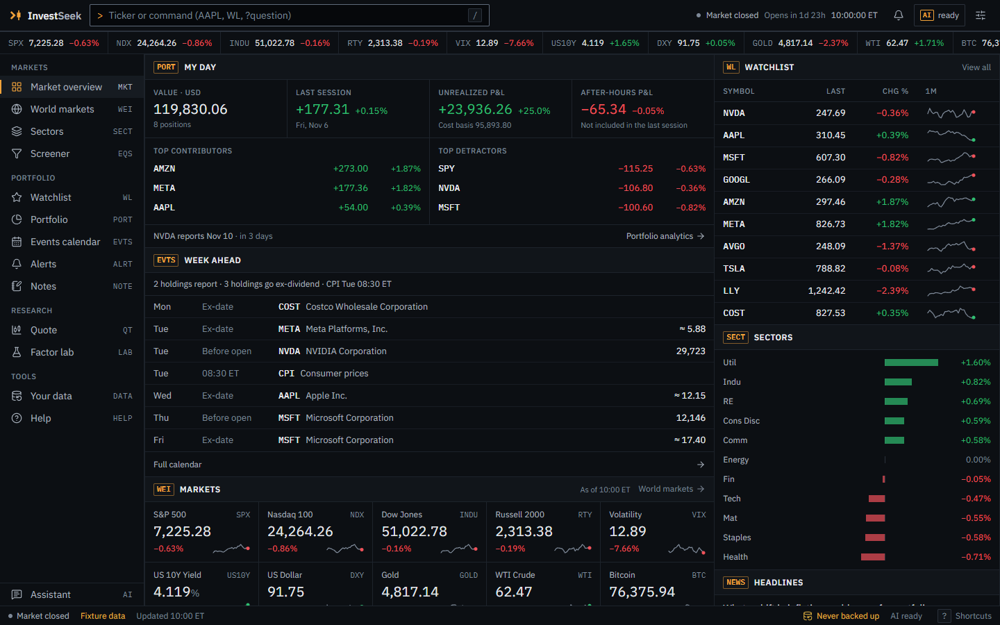

<table>
  <tr>
    <td width="33%">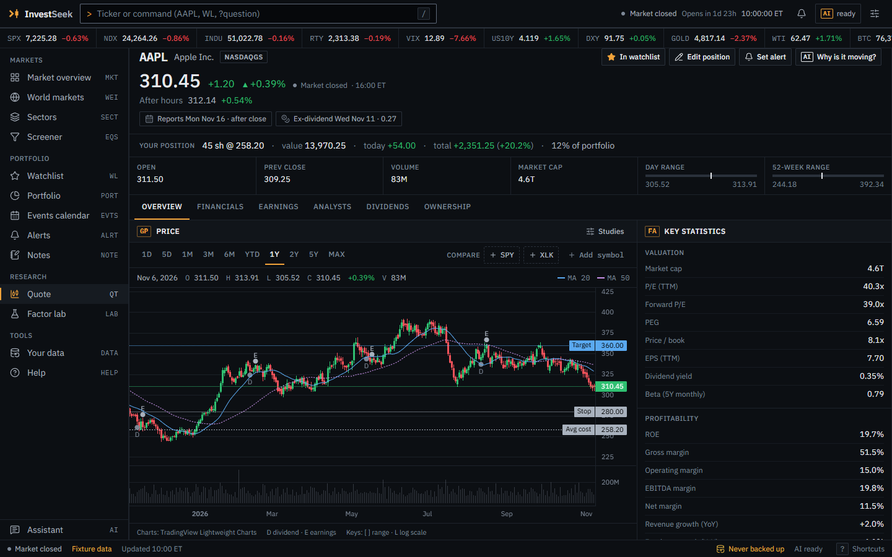<br><sub>QT · quote workstation</sub></td>
    <td width="33%">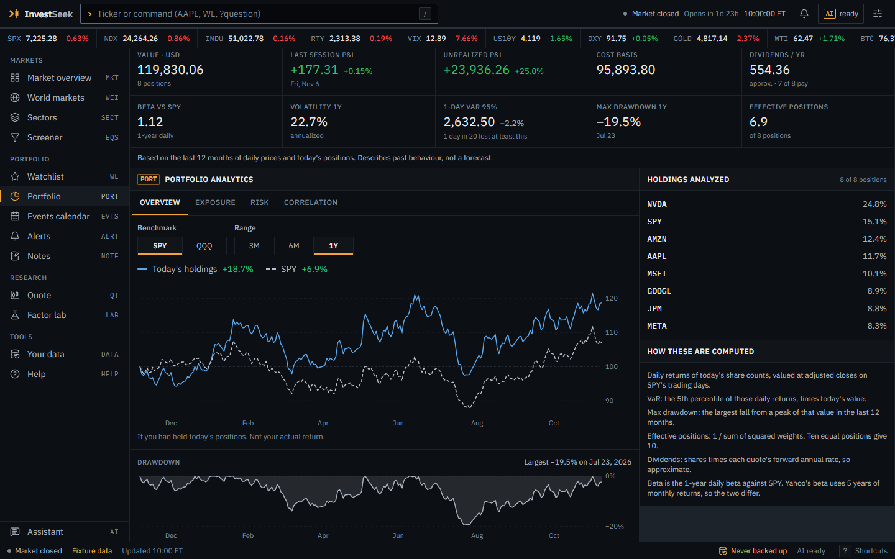<br><sub>PORT · portfolio analytics</sub></td>
    <td width="33%">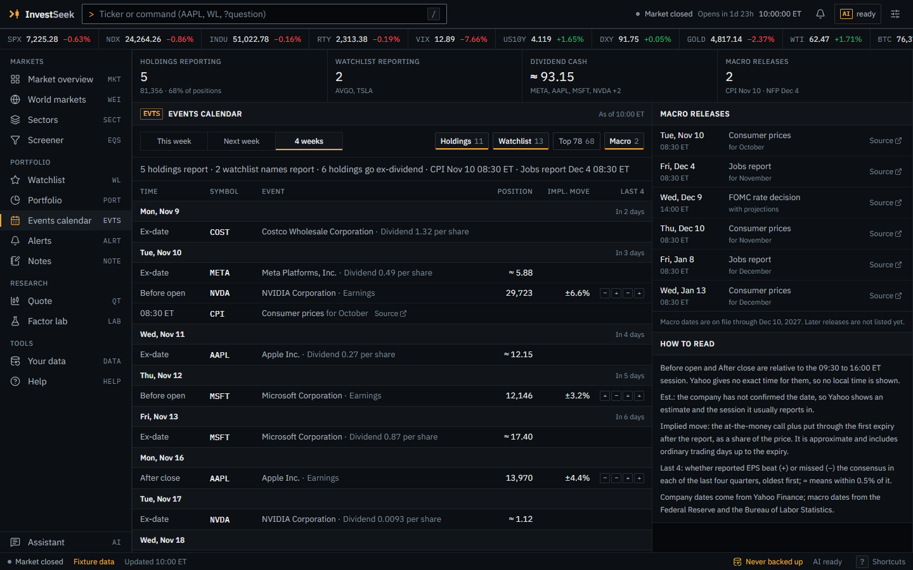<br><sub>EVTS · events calendar</sub></td>
  </tr>
  <tr>
    <td>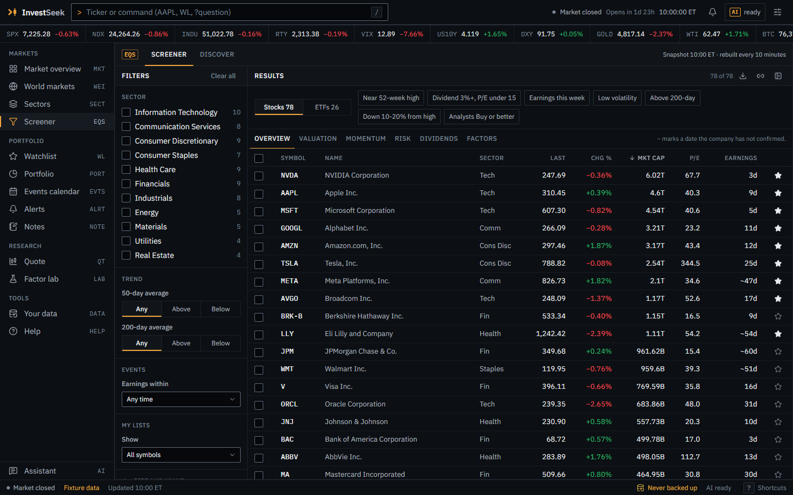<br><sub>EQS · screener</sub></td>
    <td>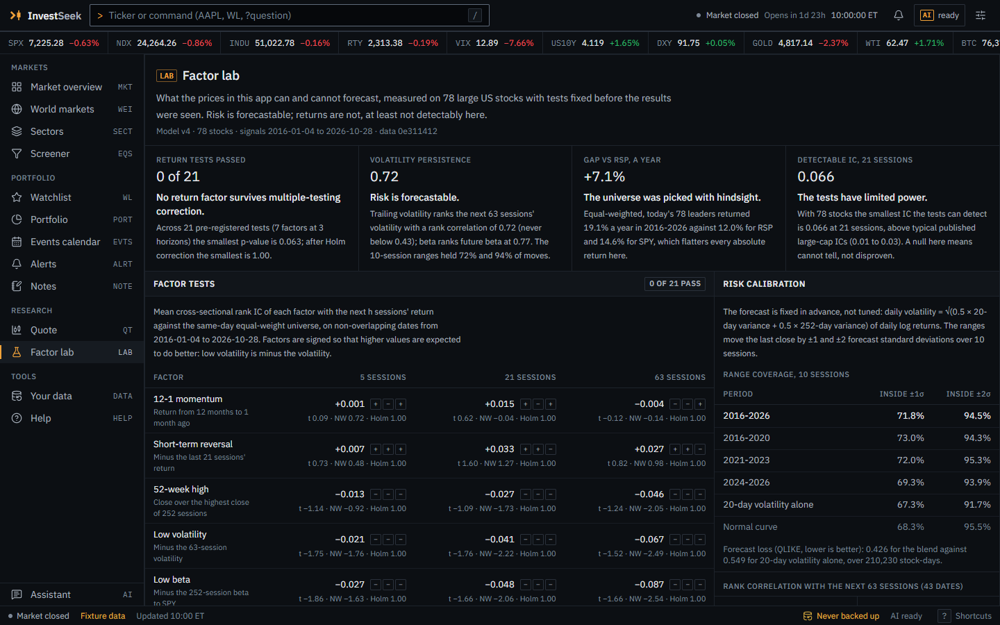<br><sub>LAB · factor lab</sub></td>
    <td>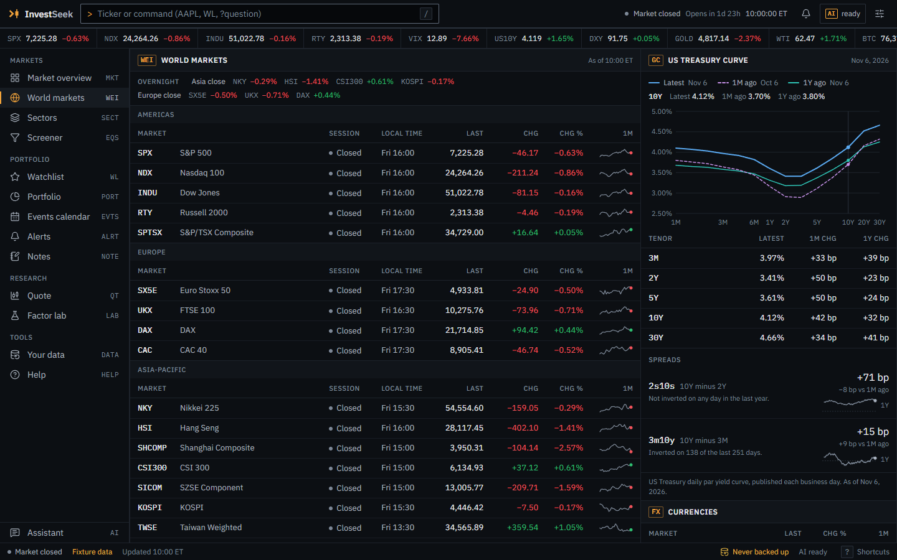<br><sub>WEI · world markets and rates</sub></td>
  </tr>
  <tr>
    <td colspan="2">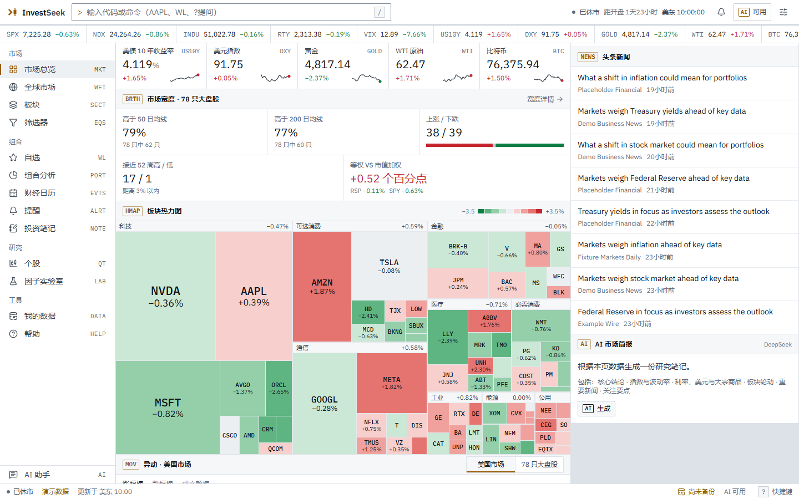<br><sub>中文 · light theme · red-up colors</sub></td>
    <td>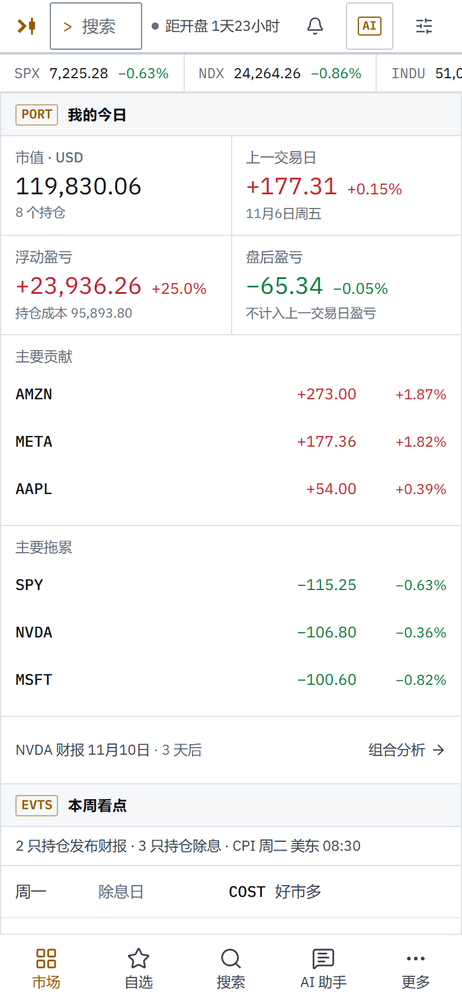<br><sub>Phone layout</sub></td>
  </tr>
</table>

## Why InvestSeek

Personal dashboards tend to show numbers without context, or wrap a chatbot around a stock price. InvestSeek borrows the habits of a professional terminal instead: dense panels, a function code for every screen, keyboard first, numbers with their source and as-of time, and every quant reading shown with the evidence behind it, including when the evidence says the model does not work. Everything personal (watchlist, positions, notes, alerts) lives in your browser; the server has no database and no accounts.

### What the numbers say

Before building more on its quant layer, version 0.3.0 tested it on pinned data with rules fixed in advance. The results changed what the app does.

- **Return signals: none found predictive.** The technical score (momentum, trend, RSI, volume), recomputed for every session of 78 large US stocks from 2016-01-04 to 2026-11-06, has a mean daily rank IC of −0.005 / −0.010 / −0.017 at 5 / 10 / 20 sessions, with Newey-West t of −0.64 / −1.06 / −1.43. No horizon reaches |t| = 2. On the holdout decade before the model's first evaluation (2014-01-02 to 2024-04-29, which overlaps the window above) its 10-session IC is −0.004 (t −0.39); v4 dropped the volatility regime after seeing those years, so for the current model it is no longer an independent test.
- **Factors: 0 of 21 tests pass.** Seven factors fixed in advance (12-1 momentum, short-term reversal, 52-week high, low volatility, low beta, the technical score and an equal-weight composite) were tested at 5, 21 and 63 sessions. None passes, even before correction: the smallest raw p is 0.063 (Holm-adjusted 1.00). With 78 names the smallest IC this design can detect is 0.033 to 0.107, above typical large-cap factor ICs, so the honest reading is "cannot tell", not "disproven".
- **The hindsight gap.** The universe is today's large caps, picked with hindsight. Equal-weighted, it returned 19.1% a year over the window, against 12.0% for RSP (the equal-weight S&P 500) and 14.6% for SPY. A backtest on such a list starts 4.6 to 7.1 points a year ahead before any signal does anything.
- **Risk is forecastable.** A fixed blend of 20- and 252-session variance gives 10-session ranges that held 71.8% of moves within ±1σ and 94.5% within ±2σ (68.3% and 95.4% for normal returns). Trailing 63-session volatility ranks next quarter's volatility with a mean rank correlation of 0.72, and trailing one-year beta ranks next quarter's beta at 0.77.

So the app forecasts ranges instead of ranking stocks. The score is shown in neutral ink as "short-term relative strength", factors appear as percentiles next to their measured evidence, risk panels carry their measured calibration, and the AI receives the same facts. The details are in [docs/evaluation.md](docs/evaluation.md) (`npm run evaluate`), [docs/factor-research.md](docs/factor-research.md) (`npm run research`) and [docs/signal-model.md](docs/signal-model.md), and in the factor lab, `/lab` in the running app ([screenshot](docs/screenshots/lab-dark-en.png)).

## Feature tour

Every screen has a function code. Type it in the command bar (`/`), or press `g` and its letter. Security functions take a ticker (`NVDA GP`) and fall back to the last symbol you viewed.

### Markets

| Code | Keys | What it does |
|---|---|---|
| `MKT` | `g m` | The home page, personal first: **My day** (value, today's P&L with the largest contributors, extended-hours P&L, the next report among your holdings) and the **week ahead**, then the markets board, breadth of the 78 large caps, a market-cap heatmap on a stepped color scale (keyboard navigable, with hover cards), movers, your watchlist, sector performance, headlines and an AI market brief. |
| `WEI` | `g x` | World markets: benchmarks of the Americas, Europe and Asia-Pacific with each exchange's session and local time, an overnight line, currencies, commodities and crypto, and breadth of the large caps by sector. |
| `GC` | `g r` | Rates: the US Treasury par yield curve against a month and a year ago, key tenors with their changes in basis points, and the 2s10s and 3m10y spreads over the past year. |
| `SECT` | `g s` | One sector: its heatmap and constituents, its ETFs with returns from 1D to YTD, news and an AI sector scan. Opens the sector you viewed last. |
| `EQS` | `g f` | Screener over 78 large caps or 26 ETFs: valuation, dividends, returns, volatility, beta, factor percentiles, trend against the 50- and 200-day averages, earnings dates and your own lists. Seven presets, six column sets, share links, CSV export and saved screens. Filtering runs in the browser over one shared snapshot. |
| `MOST` | `g t` | Discover: Yahoo's market-wide gainers, losers, most active, idea lists and trending symbols, limited to US-listed stocks priced at $2 or more with a market cap of at least the floor you pick ($300M to $100B, default $1B). Yahoo's gainers, losers and most-active lists only reach down to about $2B. |

### Portfolio

| Code | Keys | What it does |
|---|---|---|
| `WL` | `g w` | Watchlist of up to 50 symbols with sparklines, sorting or your own order, extended-hours prices and earnings badges; positions with value, weight, day, extended-hours and unrealized P&L; allocation by sector or asset class; earnings and ex-dividend dates in the next 14 days; an AI scan of the watchlist and positions. |
| `PORT` | `g p` | Portfolio analytics: value, P&L, cost basis, projected dividends, one-year beta to SPY, volatility, 1-day 95% historical VaR, maximum drawdown and the effective number of positions; how today's holdings would have done against SPY or QQQ over 3, 6 or 12 months; exposure by sector, asset class and currency; each position's share of risk. It describes how today's holdings (the 24 largest, in your base currency) behaved, not your actual returns, and it is not a forecast. |
| `CORR` | | Correlations of your holdings' daily returns over the past year, with pairs at 0.8 or more called out. |
| `EVTS` | `g e` | Events calendar for this week, next week or four weeks: earnings (before the open or after the close, estimated dates flagged), ex-dividend dates with the cash a position would receive, and FOMC, CPI and jobs releases, for your holdings, your watchlist and the 78 large caps. Reports within 14 days for your holdings and watchlist show the move the options market implies. |
| `ALRT` | `g a` | Local alerts: price at or above, price at or below, a day move, P&L from cost, earnings within N days, a cross of the 200-day average; once or daily. Checked while InvestSeek is open in a tab, with toasts and optional system notifications. A price level crossed while it was closed is reported from the daily highs and lows when you come back. |
| `NOTE` | `g n` | Thesis notes: conviction, target and stop (also drawn on the chart), review dates, tags and a dated timeline that can hold saved AI notes. `NVDA NOTE` opens one symbol's notes, and "Alert at target" or "Alert at stop" creates the alert. |

### Research

Security functions take a ticker and, typed alone, use the last symbol you viewed. `LAB` is global.

| Code | Keys | What it does |
|---|---|---|
| `QT` | `g q` | The quote page: price with extended hours, the next report and ex-dividend date, your position, and two columns of panels (chart, technical reading, risk, factor profile, AI note, notes, key statistics, earnings, analysts, news, company). |
| `DES` | | Company profile and key statistics on the quote page. |
| `GP` | | Chart workstation: ten ranges from 1D and 5D intraday (with optional extended hours) to MAX, moving averages 20/50/200, Bollinger bands, RSI, volume, log scale, dividend, split and earnings markers, and your average cost, target and stop as price lines. |
| `FA` | | Financials by year or quarter: revenue, margins, EPS, EBITDA, operating and free cash flow, buybacks and dividends paid. |
| `ERN` | | Earnings: the next report, consensus EPS and revenue with their ranges, estimate revisions over 7, 30 and 90 days, the options-implied move and the last five quarters' surprises. |
| `ANR` | | Analysts: ratings by month, the price-target range against the price, and recent rating and target changes, shown in one neutral hue because they are opinions. |
| `DVD` | | Dividends: history, yield, growth, frequency and the next ex-date; for a position, its income and its yield on cost. |
| `HDS` | | Ownership: insider and institutional shares, six months of insider buying and selling, the latest insider trades and the largest institutions. |
| `RISK` | | Risk forecast: the expected range over the next 10 sessions at ±1σ and ±2σ, forecast volatility, volatility percentiles against the stock's own year and the universe, beta, and how often stocks in its volatility quintile fell 10% or more from a peak within a month. |
| `COMP` | | Compare: `COMP AAPL MSFT SPY` draws up to three other symbols on the first one's chart, on a percentage scale. |
| `LAB` | `g l` | Factor lab: every test behind the quant numbers with its statistics (factor ICs and Holm p-values by horizon and subperiod, quintile spreads, the track record of each reading, the hindsight gap, risk calibration and statistical power). |

### Tools

| Code | Keys | What it does |
|---|---|---|
| `DATA` | `g d` | Your data: back up everything InvestSeek keeps in the browser to a JSON file and restore it (merge or replace, with a preview), import positions from broker CSV files or pasted text (English and Chinese headers), export CSV, and clear data. |
| `HELP` | `g h` | Every function with its route and keys, the command grammar, the shortcuts, and the data sources and their delays. |

### AI assistant

The assistant has no function code: type `?` and a question in the command bar, use the assistant button in the navigation, or press `w` on a quote page ("Why is it moving?"). AI needs a DeepSeek API key.

- **Research notes** for a stock, a sector, your watchlist and positions, the market, or one headline in the news reader. They stream, can be stopped and regenerated, follow a fixed outline per kind and asset class (company, fund, index, or price only for crypto, futures and currencies), and say when the length limit cut them off.
- **Chat** that knows the page you are on. "Why is it moving?" splits a move into the market, the sector and peers, and cites the company headlines that could explain the rest. Suggested questions ask about facts, never what to buy or sell.
- **Grounded on the server.** The browser names what to analyze and adds only your positions (when you allow it) and the chat messages. The rest of the context is built on the server from server-side data (quotes, statistics, earnings, the research files), with headlines and article text fenced off as untrusted text, and relations the model tends to get wrong (ranks, contributions, how much of a move the market explains) are computed and written out.
- **Your positions, your choice.** "Include my positions" (on by default) sends them with each question, and the chat says they go to DeepSeek. Notes and up to 20 chats are kept in this browser, and a note asked for again on identical data comes from a 15-minute server cache without a model call.

## Command bar and keyboard

### Command grammar

Open the command bar with `/` or `Ctrl K` (`⌘ K` on a Mac). The grammar lives in [lib/functions.ts](lib/functions.ts).

| Type | To |
|---|---|
| `PORT` | open a function |
| `GP` | run a security function on the last symbol you viewed |
| `NVDA GP` or `GP NVDA` | run a security function on a symbol |
| `COMP AAPL MSFT SPY` | compare symbols on one chart |
| `英伟达 GP`, `chart`, `图表`, `EXPORT` | use Chinese company names as symbols, and English or Chinese aliases as codes |
| `NVDA` | open the quote, or act on it: add it to the watchlist, edit the position, set an alert, ask why it is moving |
| `NVDA F` | finish a code: offers FA and the other F codes for NVDA |
| `?why is NVDA up today` | ask the assistant |
| `energy`, `dark`, `中文`, `compact` | open a sector, or switch the theme, language, price colors or density |

### Keyboard shortcuts

| Keys | Action |
|---|---|
| `/` or `Ctrl K` | Open the command bar |
| `?` | Show the shortcuts, including the current page's keys |
| `Esc` | Close the innermost panel or dialog |
| `↑` `↓` `Enter` | Move through and open command bar results |
| `g`, then a letter | Go to a function: `m` MKT, `x` WEI, `r` GC, `s` SECT, `f` EQS, `t` MOST, `w` WL, `p` PORT, `e` EVTS, `a` ALRT, `n` NOTE, `q` QT, `l` LAB, `d` DATA, `h` HELP |
| `a` `p` `n` `!` `w` | On a quote page: watchlist, position, notes, alert, why is it moving |
| `[` `]` `l` | On a quote page: previous or next chart range, log scale |
| `Alt ↑` `Alt ↓` | On the watchlist: move the focused row in your own order |

Keys never act while you type in a field or while a dialog is open.

## Architecture

Next.js 16 (App Router), React 19 and TypeScript in strict mode, Tailwind CSS v4, SWR and zod. The browser talks only to its own origin (the page CSP allows `connect-src 'self'`); route handlers call Yahoo, the US Treasury and DeepSeek from the server, and read article text from allowlisted news sites for AI notes. [types/api.ts](types/api.ts) is the contract between the two: raw numbers, `null` for missing values, and formatting in the browser with `Intl`.

### Data path

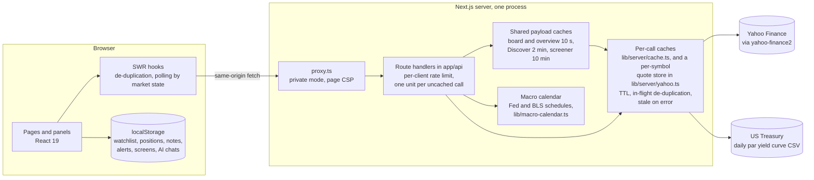

The cache tiers, from the browser out:

1. **Browser.** SWR de-duplicates requests and polls faster while a session trades (quotes every 15 seconds, otherwise every minute). Personal data lives in `localStorage` under `investseek:` keys and stays in sync across tabs.
2. **Shared CDN cache, public mode only.** Successful market data responses carry `s-maxage` (5 seconds to an hour, by route) and a `stale-while-revalidate` of four times that, so a CDN in front can share them; private mode sends `private, max-age=0`.
3. **Shared payloads.** What every visitor asks for is assembled once: the ticker board and the overview at most every 10 seconds, Discover every 2 minutes, the screener snapshot every 10 minutes, signal reports every 15 minutes.
4. **Per-call cache.** Every Yahoo and Treasury call goes through a TTL cache with in-flight de-duplication and stale-on-error (`lib/server/cache.ts`; quotes keep their own per-symbol store in `lib/server/yahoo.ts`): quotes for 15 seconds while trading and 5 minutes otherwise (served stale for up to an hour when Yahoo fails), intraday bars 1 minute while trading, daily bars 10 minutes, company data 6 to 24 hours, the Treasury file 6 hours. One shared Yahoo client has 8-second timeouts and a cap on pending calls.

### AI request path

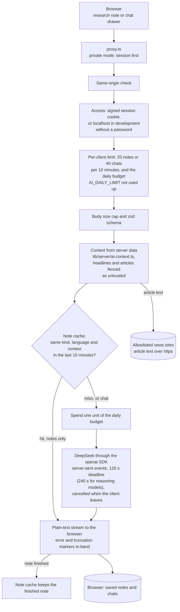

The route handlers are [app/api/ai/analyze](app/api/ai/analyze/route.ts) (notes) and [app/api/ai/chat](app/api/ai/chat/route.ts); the guard is [lib/server/request-guard.ts](lib/server/request-guard.ts). Only finished notes are cached: one that ends with an error, or whose reader left, is not.

### Research pipeline

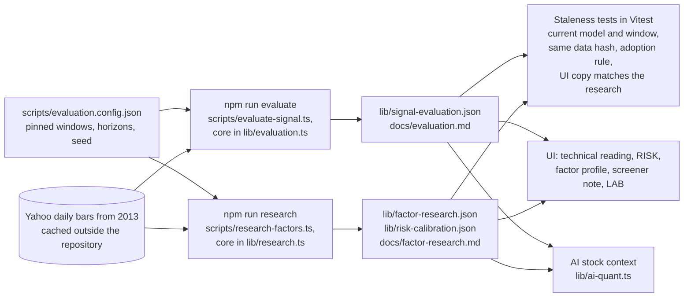

Both scripts read the same bar cache (run `npm run research -- --offline` after `npm run evaluate`), so the three JSON files carry the same data hash, `0e311412` for the published run, and rerunning on the cached bars reproduces every number exactly. Unit tests fail when the model's weights or thresholds change without a new evaluation, when the files come from different downloads, or when the copy in the app no longer matches the research.

## Data sources and limits

| Source | What | How fresh in the app | Limits |
|---|---|---|---|
| Yahoo Finance, through the unofficial [yahoo-finance2](https://github.com/gadicc/yahoo-finance2) | Quotes, charts, fundamentals, earnings, analysts, options, ownership, news, search and market screens | Quotes 15 s while a session trades, 5 min otherwise; intraday bars 1 min while trading; daily bars and news 10 min; company data 6 to 24 h | Not an official API and not endorsed by Yahoo. Delays depend on the exchange, data can be incomplete or wrong, and access can break when Yahoo changes it (a weekday canary watches for that). Yahoo's terms govern how its data may be used. InvestSeek is meant for one person's own research, but in the default public mode it serves Yahoo's data to anyone who can reach it (and lets a CDN cache it), so use [private mode](#private-mode) on any public address. |
| U.S. Department of the Treasury | Daily par yield curve, one CSV per year | Each year's file is cached 6 h and served stale for up to 48 h | No key. In early January the new year's file is empty until Treasury's first release, and the curve comes from the previous year. |
| Federal Reserve and Bureau of Labor Statistics | Dates of FOMC decisions, CPI and the jobs report | Compiled into [lib/macro-calendar.ts](lib/macro-calendar.ts) through December 2027 | The list is extended by hand when the agencies publish the next schedule; the calendar page shows where it ends. |
| DeepSeek | AI notes and chat | Per request; identical notes are cached 15 min | Needs an API key and a prepaid balance. Notes can be wrong. The context of each request, including your positions when you allow it, is sent to DeepSeek. |

What is cached where:

- **Server memory, per process:** the market data caches (up to 3,000 entries plus 5,000 quotes), one Yahoo session cookie and crumb, the AI note cache (up to 200 notes for 15 minutes), the rate limits and the daily AI budget. Nothing is written to disk, and a restart starts clean.
- **CDN, public mode only:** API responses for 5 seconds to an hour.
- **Browser:** SWR's in-memory cache; `localStorage` for everything personal (watchlist, positions, notes, alerts and their log, saved screens, chart settings, recent symbols, AI notes and chats); cookies for display preferences and the session.
- **Research runs:** the bar cache of `npm run evaluate` lives outside the repository.

## Self-hosting

InvestSeek is built for one person. A single long-running process keeps the caches warm and makes the rate limits and the AI budget exact, so an always-on machine with Docker is the best fit. Everything except AI works without any setting. [docs/deployment.md](docs/deployment.md) covers each option in depth.

### Docker (recommended)

Requirements: Docker Engine with Compose v2.24 or newer. The build downloads the IBM Plex fonts from Google Fonts, so it needs network access; the running image serves the fonts itself and only needs outbound HTTPS to Yahoo, the Treasury, DeepSeek and the allowlisted news sites.

```bash
git clone https://github.com/DestRoyOvO/invest-app.git
cd invest-app
cp .env.example .env.local        # optional: DEEPSEEK_API_KEY, ACCESS_PASSWORD, SESSION_SECRET
docker compose up -d --build      # http://127.0.0.1:3000
```

The image runs Next.js's standalone server as an unprivileged user and has a liveness health check (`/api/health`; uptime monitors use `/api/health?ready=1`). Compose restarts it after a crash or a reboot and publishes its port on 127.0.0.1 only. For HTTPS on your own domain, the optional Caddy service obtains a certificate automatically:

```bash
SITE_DOMAIN=invest.example.com docker compose --profile https up -d --build
```

On a public address, also turn on [private mode](#private-mode). See [HTTPS with Caddy](docs/deployment.md#https-with-caddy) for DNS and ports.

### Node.js

Requirements: Node.js 22.12 or newer (see `.nvmrc`).

```bash
npm ci
npm run build
npm start          # port 3000; behind your own TLS reverse proxy, set TRUST_PROXY=1
```

For development, `npm run dev` serves http://127.0.0.1:3000 with hot reload. Without `ACCESS_PASSWORD` the AI features are open there, on localhost only.

### Vercel

Import the repository and set at least `DEEPSEEK_API_KEY`, `ACCESS_PASSWORD` and `SESSION_SECRET`. It works, with caveats ([details](docs/deployment.md#vercel)):

- Caches, rate limits and the daily AI budget live in each serverless instance, so `AI_DAILY_LIMIT` is not a hard cap there. Keep the DeepSeek balance small: it is the real cap.
- A cold instance starts with empty caches and repeats Yahoo's cookie and crumb handshake, so the first page after a quiet spell is slower.
- The AI routes allow up to 250 seconds (`maxDuration`), which needs Fluid compute; without it the Hobby plan stops functions after 60 seconds and long notes are cut off.
- Yahoo throttles some cloud IP ranges. Check a preview deployment before relying on it.

### Private mode

By default (`SITE_ACCESS=public`) the market pages and data are open to anyone who can reach the server, and only AI needs the password. With `SITE_ACCESS=private` every page and API route asks for it first, except `/api/health`, the sign-in routes, the unlock page and static assets. It needs `ACCESS_PASSWORD` (at most 256 characters; 12 or more recommended) and a `SESSION_SECRET` of 32 or more characters, and a production server refuses to start without them. Sessions last 30 days, changing either value signs every browser out, and pages and API responses are marked `noindex`. Use it for any deployment on a public address. More in [docs/deployment.md](docs/deployment.md#private-site-mode).

### Environment variables

From [.env.example](.env.example); a blank value means the default. The server validates the settings at startup and logs each problem on its own line ([startup checks](docs/deployment.md#startup-checks)).

| Variable | Default | Purpose |
|---|---|---|
| `DEEPSEEK_API_KEY` | none | DeepSeek API key for the AI notes and chat. Without it AI reports "not configured"; everything else works. |
| `DEEPSEEK_MODEL` | `deepseek-chat` | Model id. Reasoning models get larger token limits and a longer deadline. |
| `DEEPSEEK_BASE_URL` | `https://api.deepseek.com` | API base URL. https only; plain http is accepted only for localhost (mock servers in tests). |
| `AI_DAILY_LIMIT` | `200` | AI requests per UTC day for one server process. DeepSeek's prepaid balance stays the hard cap. |
| `ACCESS_PASSWORD` | none | Unlocks AI, and the whole site in private mode; at most 256 characters, 12 or more recommended (startup logs shorter ones as weak). Required for AI in production; optional in development, where AI is open on localhost. |
| `SESSION_SECRET` | none | Signs the session cookie: 32 or more random characters, required with `ACCESS_PASSWORD`. |
| `SITE_ACCESS` | `public` | `public` or `private` (see [Private mode](#private-mode)). |
| `TRUST_PROXY` | off | `1` behind your own reverse proxy that appends the client address to `X-Forwarded-For`, so rate limits see real clients. Docker Compose sets `1` itself; not needed on Vercel. |
| `SITE_URL` | none | Public address of the deployment, e.g. `https://invest.example.com`, for absolute links. |
| `LOG_LEVEL` | `info` | `debug`, `info`, `warn`, `error` or `silent`. Logs are one JSON object per line. |
| `MARKET_DATA_SOURCE` | `yahoo` | Where market data comes from. Leave it at `yahoo`; any other value is for the end-to-end suite (see [Testing](#testing)). |

Generate a session secret with `node -e "console.log(require('crypto').randomBytes(32).toString('hex'))"`.

### Security notes

- **Content-Security-Policy.** In production every page gets a fresh nonce (`script-src 'self' 'nonce-…' 'strict-dynamic'`) and may only connect to its own origin; API responses get `default-src 'none'`. HSTS, `X-Frame-Options: DENY`, `nosniff`, a strict referrer policy and a permissions policy come from `next.config.ts`.
- **Session cookie.** HMAC-signed, `HttpOnly`, `SameSite=Lax` and, in production, `Secure` with the `__Host-` prefix. Sign-in allows 5 attempts per client and 30 per server in 15 minutes, and failures are logged without the password.
- **AI and API abuse.** AI routes check the origin, the session, per-client limits, the daily budget, the body size and a zod schema before any model call. Public market routes are rate limited per client and charge one unit per uncached Yahoo call.
- **Article fetching.** News text for an AI analysis is read only from allowlisted hosts over https and from public addresses (checked inside the DNS lookup), with every redirect re-checked and time and size capped.
- **Logs** never contain passwords, cookies, keys, prompts or chat messages.

Please report vulnerabilities privately, as described in [SECURITY.md](SECURITY.md).

## Scripts

| Script | What it does |
|---|---|
| `npm run dev` | Development server on 127.0.0.1:3000 |
| `npm run build` | Production build, including the standalone server the Docker image runs |
| `npm start` | Production server on port 3000 |
| `npm run lint` | ESLint |
| `npm run typecheck` | `tsc --noEmit` |
| `npm test` | Vitest unit tests, once |
| `npm run test:watch` | Vitest in watch mode |
| `npm run check` | Lint, typecheck and unit tests, as CI runs them |
| `npm run evaluate` | Universe evaluation of the technical score: downloads daily bars from 2013 for the 78 stocks, SPY and RSP, and rewrites `docs/evaluation.md` and `lib/signal-evaluation.json` (`-- --offline` reruns from the cache) |
| `npm run research` | Pre-registered factor study and risk calibration: rewrites `docs/factor-research.md`, `lib/factor-research.json` and `lib/risk-calibration.json` (run `-- --offline` after `evaluate` to use the same bars) |

Other tools, run with `npx tsx`: `scripts/check-contrast.ts` (WCAG contrast of every design token pair), `scripts/check-links.ts` (relative links and images in the Markdown docs) and `scripts/smoke-yahoo.ts` (the live Yahoo contract; add `--conditions=react-server`).

## Testing

- **Unit tests:** more than 1,700 Vitest tests (`npm test`). They cover the signal engine and its statistics, the evaluation and research cores, portfolio and risk math, alerts, backup and CSV import, the command parser, AI context building and streaming, the SSRF guard, sessions, rate limits, settings validation, route handlers and the contrast of the design tokens. They never call Yahoo or DeepSeek.
- **CI:** lint, typecheck, unit tests, a production build, an audit of production dependencies and the end-to-end suite on every pull request and every push to `main`. A second workflow builds the Docker image and waits for its health check when deployment files change, and a weekday canary checks the live Yahoo contract.

<!-- e2e: the end-to-end suite is described only in this block and its twin in README.zh-CN.md; other docs link here. Keep both blocks in step. -->
**End-to-end and accessibility:** `npm run e2e` builds the app and runs the Playwright suite against synthetic fixture data (`MARKET_DATA_SOURCE=fixtures`) and a mock LLM, with the server's network blocked and its clock pinned, so it never calls Yahoo or DeepSeek. It opens every page route on a desktop and a phone viewport and runs axe on each page, the command bar and the AI chat in both themes. [docs/testing.md](docs/testing.md) is the reference.
<!-- /e2e -->

## Project structure

```
app/                 routes: (terminal)/ pages, api/ route handlers, the unlock page, icons, manifest, social card
components/          feature UI by module (market, markets, stock, portfolio, calendar, screener, lab, alerts,
                     notes, data, ai ...), the shell (command bar, navigation, status bar) and ui/ primitives
hooks/               SWR data hooks, local stores, AI streaming, page hotkeys
lib/                 pure logic: function registry, signal model, risk forecast, factors, statistics, portfolio
                     analytics, alerts, backup and CSV, i18n in English and Chinese, formatting; research JSON files
lib/server/          server only: settings, Yahoo client and caches, Treasury, calendar, screener, AI context,
                     prompts and DeepSeek client, sessions, rate limits, logs, health
scripts/             evaluation and factor research, contrast check, link check, Yahoo smoke test
types/               the client-server contract (api.ts and per-feature types)
docs/                design system, signal model, evaluation, factor research, deployment, roadmap, screenshots
.github/             CI, Docker image check, Yahoo canary, Dependabot, issue forms
proxy.ts             runs before every request: private mode and the page CSP
instrumentation.ts   startup checks of the settings
```

## Roadmap and limitations

Limitations, plainly:

- **Data.** Yahoo is unofficial and delayed, and it can break without notice. Exchange times are US Eastern, and the session clock does not know holidays or early closes.
- **Research.** 78 of today's large caps (hindsight), one decade of mostly rising markets, prices only (fundamentals have no point-in-time history here). Nothing in the app is a validated return forecast, and the app does not present anything as one.
- **Portfolio.** The analytics describe how today's holdings behaved, not your actual returns: there is no trade ledger, so no time- or money-weighted return. Totals cover your base currency.
- **Alerts** run only while InvestSeek is open in a browser tab; there is no server push.
- **Your data lives in one browser.** There is no account and no sync; use `DATA` to back it up or move it.
- **One process.** Caches, limits and the AI budget are kept in memory per instance, with no shared store for several instances.
- **The macro calendar** is a hand-maintained list that ends in December 2027.
- **AI notes can be wrong**, and what you send goes to DeepSeek.

Next, from the deferred list of the [v0.3 roadmap](docs/roadmap-v0.3.md): a point-in-time universe with SEC EDGAR fundamentals, so value and quality can be tested without hindsight; a trade ledger with time- and money-weighted returns once CSV import has settled; a screener over the whole S&P 500; shared rate limits for multi-instance deployments; and structured AI output with a source for every figure.

## Contributing

Issues and pull requests are welcome. [CONTRIBUTING.md](CONTRIBUTING.md) covers setup, checks and conventions. In short: run `npm run check`, put tests next to the code, write every UI string in English and Chinese through `lib/i18n`, keep red and green for prices and P&L, describe rather than prescribe (no investment advice), and use Conventional Commits. A change to the model needs a fresh `npm run evaluate` followed by `npm run research -- --offline`.

## License

[MIT](LICENSE)

## Disclaimer

InvestSeek is a personal research tool. It describes markets and your own positions and does not recommend buying or selling anything. Nothing it shows, including model readings, risk ranges and AI notes, is investment advice. Market data may be delayed, incomplete or wrong.
