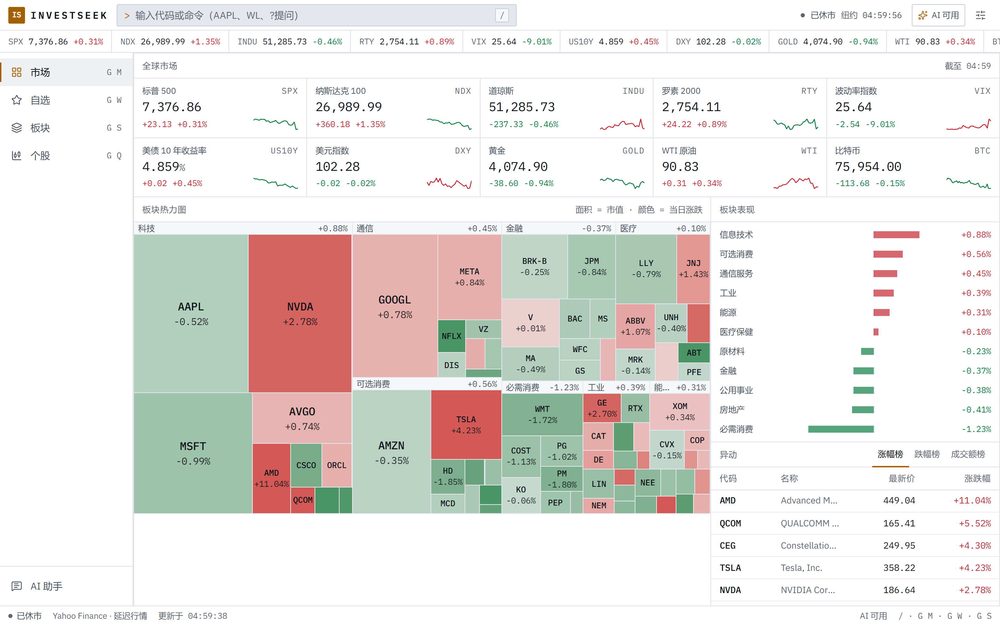
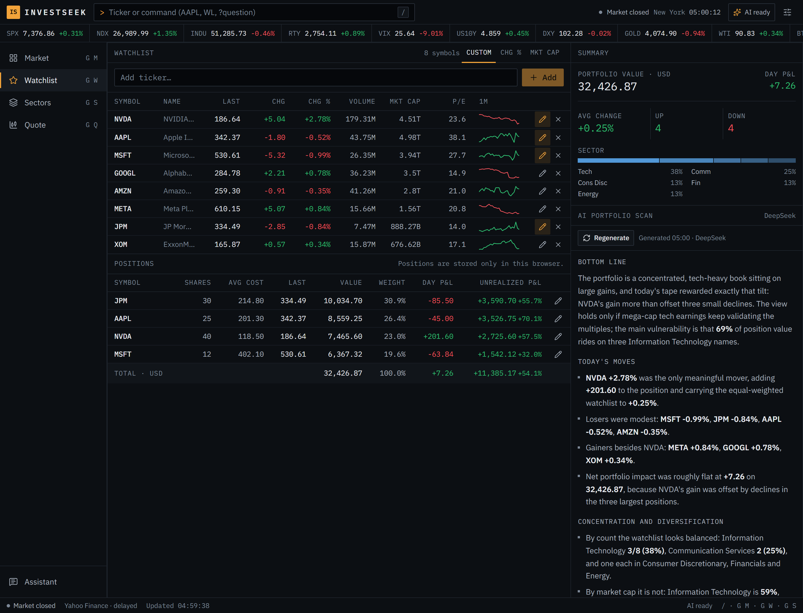
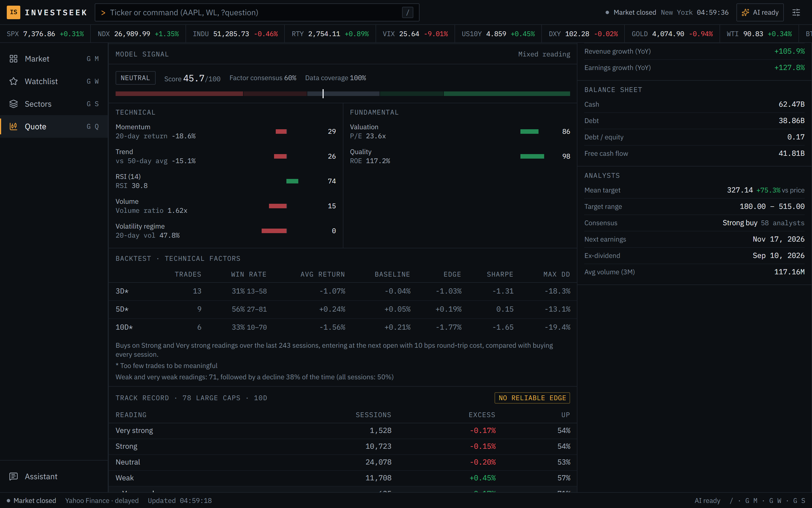

# InvestSeek

**一个终端风格、为个人投资者打造的行情研究工作站。** 实时行情、市值热力图、持仓跟踪、公开自身历史表现的量化评分，以及基于服务端数据的 AI 研究笔记，支持中英文。

[English](README.md)



## 设计理念

很多个人看盘工具要么只堆数字、没有上下文，要么在股价外面套一个聊天机器人。InvestSeek 借鉴专业终端的习惯：信息密集、键盘优先、每个数字都有来源，每个模型输出都同时给出依据和局限，哪怕证据表明模型并不灵验。

## 亮点

- **自己检验自己的信号，并把结果摆在你面前。** 在 78 只美股大盘股、约两年半的数据上做离线评估后发现：技术评分没有可靠的预测力，偏弱读数之后的收益反而高于平均。因此界面把评分改为描述当前形态的“读数”，在每个评分下方展示这份历史表现，并把同样的事实告诉 AI。详见下文[评估结论](#评估结论)。
- **懂持仓的 AI。** 录入股数和成本后，AI 组合扫描会按持仓市值（而不是股票个数）分析集中度、风险和当日盈亏。
- **有据可查的 AI，隔离不可信输入。** 提示词完全由服务端根据服务端数据组装；新闻标题和正文被标记为不可信数据；请求有频率限制、每日预算，并且可以随时取消。
- **工程化习惯。** 前后端共享类型契约、分层缓存与并发请求合并、安全响应头和 CSP、防 SSRF 的文章抓取、400 多个单元测试和 CI。

<p>
  
  
</p>

## 功能

**市场总览**
- 指数、利率、汇率、大宗商品和加密货币看板，附近一个月走势。
- 78 只美股大盘股的板块热力图：面积表示市值，颜色表示当日涨跌。
- 板块表现、异动榜（涨幅、跌幅、成交额）和市场头条。

**个股页**
- K 线图，含成交量和 20/50 周期均线，六种时间范围。
- 按估值、盈利能力、资产负债和分析师共识分组的关键数据；盘前盘后价格；公司概况。
- 按相关性打分的新闻，并标注为公司、行业或宏观背景。

**自选与持仓**
- 自选列表带迷你走势、排序和板块分布，保存在浏览器本地：无需账号，没有追踪。
- 录入股数和平均成本，按单只和合计显示市值、权重、当日盈亏和浮动盈亏。
- AI 组合扫描同时阅读你的持仓和自选。

**可审计的量化评分**
- 七个基于规则的因子（动量、趋势、RSI、量能、估值、质量、波动状态），每个因子都显示原始数据；缺失数据会明确标出，而不是悄悄当作中性分。
- 综合分以“读数”呈现（强势 / 偏强 / 中性 / 偏弱 / 弱势），并附因子一致度和数据覆盖，绝不包装成买卖建议。
- 单只股票、仅用技术面因子、约 250 个交易日的回测：次日开盘买入、计入交易成本，展示交易笔数、Wilson 置信区间，并与每天无条件买入的基准对比。
- `npm run evaluate` 生成的全市场历史表现直接显示在评分下方：各档读数之后的收益相对基准的超额，以及横截面秩相关 IC。如果改了权重或阈值却没有重新评估，单元测试会失败。
- 完整方法与局限见 [docs/signal-model.md](docs/signal-model.md)，最新评估见 [docs/evaluation.md](docs/evaluation.md)。

**AI 研究笔记（DeepSeek）**
- 可针对个股、板块、持仓组合、整体市场或单条新闻生成笔记，流式输出、随时可停止；因长度上限被截断的回答会明确提示。
- 上下文完全由服务端根据服务端数据构建（行情、关键数据、技术指标、量化评分及其历史表现、持仓、新闻），不接受浏览器传来的自由文本；第三方内容会被标记为不可信数据。
- 研究助手知道你当前所在的页面。

**终端体验**
- 命令栏（`/` 或 `Ctrl K`）：输入代码、`WL`、板块名或 `?你的问题`。
- 快捷键：`g m` 市场、`g w` 自选、`g s` 板块、`g q` 最近查看的个股。
- 深色和浅色主题，红涨绿跌或绿涨红跌，中英文切换。
- 适配手机屏幕，底部有标签栏。

## 评估结论

`npm run evaluate` 会对 78 只美股大盘股逐日重算技术评分（信号区间 2024-04-30 至 2026-11-06），次日开盘买入，按未扣成本的收益统计。下表是 2026 年 11 月的结果，最新一次运行以 [docs/evaluation.md](docs/evaluation.md) 为准。

| 持有期 | 秩 IC（t 值） | 强势读数的超额收益 | 弱势读数的超额收益 |
|---|---|---|---|
| 5 个交易日 | −0.025（−1.44） | −0.16% | +1.55% |
| 10 个交易日 | −0.044（−1.69） | −0.17% | +2.17% |
| 20 个交易日 | −0.026（−0.81） | −1.02% | +2.07% |

各持有期、前后两个半段的相关性都为负，但都不显著（|t| < 2），而且方向与趋势跟踪的逻辑相反，符合大盘股常见的短期反转效应。我们没有用这一段数据重新拟合权重，否则只是把过拟合换个地方；改变的是产品本身：措辞中性化、公开历史表现，并让 AI 知道同样的事实。

## 快速开始

需要 Node.js 20.9 或更高版本（推荐 22）。DeepSeek API Key 可选，不配置时除 AI 外的功能都可正常使用。

```bash
git clone https://github.com/DestRoyOvO/invest-app.git
cd invest-app
npm install
cp .env.example .env.local   # 然后填入 DEEPSEEK_API_KEY
npm run dev                  # http://127.0.0.1:3000
```

环境变量说明见 [.env.example](.env.example)。部署到生产环境时，需要同时设置 `ACCESS_PASSWORD` 和 `SESSION_SECRET` 才会开启 AI 功能；自建服务器放在反向代理后面时，再设置 `TRUST_PROXY=1`，让频率限制使用真实的客户端地址。

## 免责声明

行情数据来自 Yahoo Finance（通过非官方的 yahoo-finance2 库），可能有延迟、缺失或错误。InvestSeek 是个人研究工具，其中的任何内容（包括量化读数和 AI 笔记）都不构成投资建议。

## 许可证

[MIT](LICENSE)
