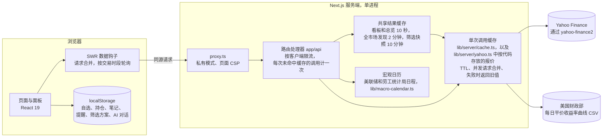
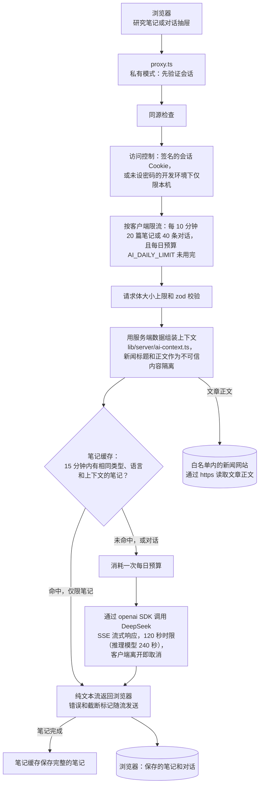
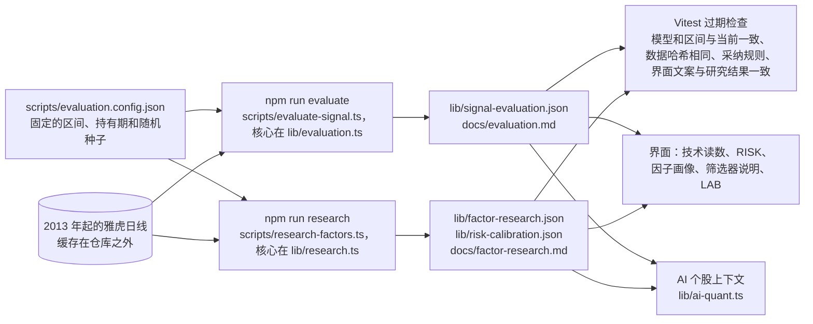

# InvestSeek

**一个可以自己部署的行情终端，为个人投资者而做：每个页面都有功能代码，信息围绕你的持仓组织，量化部分连自己没通过的检验也一并公开。** 支持中文和 English。

[English](README.md) · [文档](docs/README.md) · [用 Docker 部署](docs/deployment.md#docker) · [更新日志](CHANGELOG.md)

[](https://github.com/DestRoyOvO/invest-app/actions/workflows/ci.yml)
[](LICENSE)


<table>
  <tr>
    <td width="33%"><br><sub>QT · 个股工作台</sub></td>
    <td width="33%"><br><sub>PORT · 组合分析</sub></td>
    <td width="33%"><br><sub>EVTS · 财经日历</sub></td>
  </tr>
  <tr>
    <td><br><sub>EQS · 筛选器</sub></td>
    <td><br><sub>LAB · 因子实验室</sub></td>
    <td><br><sub>WEI · 全球市场与利率</sub></td>
  </tr>
  <tr>
    <td colspan="2"><br><sub>English · 深色主题</sub></td>
    <td><br><sub>手机布局</sub></td>
  </tr>
</table>

## 为什么做 InvestSeek

个人看盘工具大多要么只堆数字、没有上下文，要么在股价外面套一个聊天机器人。InvestSeek 借鉴的是专业终端的习惯：面板紧凑，每个页面都有功能代码，键盘优先，数字标明来源和数据时间，每个量化读数都附上依据，哪怕依据表明模型并不管用。自选、持仓、笔记、提醒这些个人数据只存在你的浏览器里，服务器没有数据库，也没有账号。

### 数据怎么说

在给量化部分继续加功能之前，0.3.0 先在固定的数据上、按事先定好的规则把它检验了一遍。结果改变了这个应用的做法。

- **收益信号：没有找到有预测力的。** 技术评分（动量、趋势、RSI、成交量）在 78 只美股大盘股上逐日重算，信号区间为 2016-01-04 至 2026-11-06。5 / 10 / 20 个交易日的日均秩 IC 分别为 −0.005 / −0.010 / −0.017，Newey-West t 值为 −0.64 / −1.06 / −1.43，没有一个持有期达到 |t| = 2。在模型首次评估之前十年的留出样本上（2014-01-02 至 2024-04-29，与上面的区间有重叠），10 日 IC 为 −0.004（t 值 −0.39）；不过 v4 去掉波动率状态是在看过这段数据之后决定的，因此对当前模型而言，它已不是独立的检验。
- **因子：21 项检验无一通过。** 事先登记的 7 个因子（12-1 动量、短期反转、52 周高点、低波动、低 Beta、技术评分和等权复合因子）分别在 5、21、63 个交易日上检验，全部未通过，即使不做多重检验校正也是如此（最小的原始 p 值为 0.063，Holm 校正后为 1.00）。只有 78 只股票时，这套设计能检测到的最小 IC 在 0.033 到 0.107 之间，高于大盘股因子常见的 IC 水平，所以准确的说法是“无法判断”，而不是“已被否定”。
- **后见之明带来的收益缺口。** 股票池是今天的大盘股，本身就是事后挑出来的。等权持有，它在评估区间内年化收益 19.1%，同期 RSP（标普 500 等权）为 12.0%，SPY 为 14.6%。在这样一份名单上做回测，信号还没起作用，每年就已经领先 4.6 到 7.1 个百分点。
- **风险可以预测。** 用 20 日与 252 日方差的固定混合算出的 10 日波动区间，±1σ 覆盖了 71.8% 的实际走势，±2σ 覆盖了 94.5%（正态分布下分别为 68.3% 和 95.4%）。用过去 63 日的波动率给下一季度的波动率排序，平均秩相关系数为 0.72；用过去一年的 Beta 给下一季度的 Beta 排序，平均秩相关系数为 0.77。

所以这个应用预测的是区间，而不是给股票排名次：评分用中性色显示，称为“短期相对强弱”；因子以分位数呈现，旁边写着实测证据；风险面板标出实测覆盖率；AI 拿到的也是同样的事实。详见 [docs/evaluation.md](docs/evaluation.md)（`npm run evaluate`）、[docs/factor-research.md](docs/factor-research.md)（`npm run research`）和 [docs/signal-model.md](docs/signal-model.md)，以及运行中应用里的因子实验室 `/lab`（[截图](docs/screenshots/lab-dark-en.png)）。

## 功能导览

每个页面都有功能代码。在命令栏（`/`）里输入代码，或者先按 `g` 再按对应字母。个股功能需要搭配股票代码（`NVDA GP`），只输入功能代码时默认用你最近查看的股票。

### 市场

| 代码 | 按键 | 功能 |
|---|---|---|
| `MKT` | `g m` | 首页，个人信息优先：**我的今日**（市值、当日盈亏和贡献最大的持仓、盘前盘后盈亏、持仓中的下次财报）和**本周看点**，然后是行情看板、78 只大盘股的市场宽度、按分档色阶着色的市值热力图（可用键盘浏览，带悬停卡片）、异动榜、自选、板块表现、头条新闻和 AI 市场简报。 |
| `WEI` | `g x` | 全球市场：美洲、欧洲和亚太的主要指数，附各交易所的交易时段和当地时间；一行隔夜行情概览；汇率、大宗商品和加密货币；以及按板块统计的大盘股市场宽度。 |
| `GC` | `g r` | 利率：美国国债平价收益率曲线，与一个月前和一年前对比；关键期限的收益率及其变动（基点）；过去一年的 2s10s 和 3m10y 利差。 |
| `SECT` | `g s` | 单个板块：板块热力图和成分股、相关 ETF 从 1 日到年初至今的收益、新闻和 AI 板块扫描。默认打开你最近看过的板块。 |
| `EQS` | `g f` | 筛选器，覆盖 78 只大盘股或 26 只 ETF：估值、股息、收益率、波动率、Beta、因子分位、相对 50 日和 200 日均线的位置、财报日期，以及你自己的名单。7 个预设、6 组列、可分享的链接、CSV 导出和保存的方案。筛选在浏览器里对同一份共享快照进行。 |
| `MOST` | `g t` | 全市场发现：雅虎的涨幅榜、跌幅榜、成交活跃榜、创意清单和热门代码，只保留股价不低于 2 美元、市值不低于所选门槛（3 亿到 1000 亿美元，默认 10 亿美元）的美国上市股票。雅虎的涨幅榜、跌幅榜和成交活跃榜本身只收录市值约 20 亿美元以上的公司。 |

### 组合

| 代码 | 按键 | 功能 |
|---|---|---|
| `WL` | `g w` | 最多 50 只股票的自选：迷你走势、排序或自定义顺序、盘前盘后价格、财报标记；持仓的市值、权重、当日盈亏、盘前盘后盈亏和浮动盈亏；按板块或资产类别的配置；未来 14 天的财报和除息日；对自选和持仓的 AI 扫描。 |
| `PORT` | `g p` | 组合分析：市值、盈亏、成本、预计股息、相对 SPY 的一年 Beta、波动率、1 日 95% 历史 VaR、最大回撤和有效持仓数；假设一直持有当前持仓，过去 3、6 或 12 个月相对 SPY 或 QQQ 的表现；按板块、资产类别和币种的暴露；各持仓对组合风险的贡献。它描述的是当前持仓（以本位币计价、市值最大的 24 只）过去的表现，不是你的实际收益，也不是预测。 |
| `CORR` | | 过去一年各持仓日收益的相关性，并单独列出相关系数在 0.8 以上的两两组合。 |
| `EVTS` | `g e` | 本周、下周或未来 4 周的财经日历：财报（盘前或盘后，预估日期会标出）、除息日及持仓可收到的现金，以及 FOMC、CPI 和非农数据发布，覆盖你的持仓、自选和 78 只大盘股。你的持仓和自选中 14 天内发布的财报会显示期权市场隐含的波动幅度。 |
| `ALRT` | `g a` | 本地提醒：价格涨到或跌到某个价位、当日涨跌幅、相对成本的盈亏、N 天内发布财报、穿越 200 日均线；可以只提醒一次，也可以每天提醒。InvestSeek 在浏览器标签页中打开时才会检查，以页面提示和可选的系统通知告诉你。关闭期间穿越的价位，会在你回来时根据日线最高价和最低价补报。 |
| `NOTE` | `g n` | 投资笔记：信心程度、目标价和止损位（也会画在图表上）、复盘日期、标签，以及可以存入 AI 笔记、按日期排列的时间线。`NVDA NOTE` 打开单只股票的笔记，“目标价提醒”和“止损位提醒”会直接创建提醒。 |

### 研究

个股功能需要搭配股票代码，只输入功能代码时用你最近查看的股票。`LAB` 是全局功能。

| 代码 | 按键 | 功能 |
|---|---|---|
| `QT` | `g q` | 个股页：含盘前盘后的价格、下次财报和除息日、你的持仓，以及两栏面板（图表、技术读数、风险、因子画像、AI 笔记、投资笔记、关键数据、财报、分析师、新闻、公司概况）。 |
| `DES` | | 个股页上的公司概况和关键数据。 |
| `GP` | | 图表工作台：从 1 日、5 日分时（可显示盘前盘后）到全部历史共十种区间，20/50/200 日均线、布林带、RSI、成交量、对数坐标，分红、拆股和财报标记，以及你的平均成本、目标价和止损位价格线。 |
| `FA` | | 按年度或季度的财务数据：营收、利润率、每股收益、EBITDA、经营现金流和自由现金流、回购和已付股息。 |
| `ERN` | | 财报：下次财报、每股收益和营收的一致预期及区间、过去 7、30、90 天的预期修正、期权隐含的波动幅度，以及最近五个季度的超预期情况。 |
| `ANR` | | 分析师：按月的评级分布、目标价区间与现价的对比、近期评级和目标价变动。这些都是观点，所以统一用一种中性色显示。 |
| `DVD` | | 股息：派息历史、股息率、增长、频率和下一个除息日；有持仓时还显示股息收入和按成本计算的股息率。 |
| `HDS` | | 持股结构：内部人和机构持股、近六个月内部人的买卖、最新的内部人交易和最大的机构股东。 |
| `RISK` | | 风险预测：未来 10 个交易日 ±1σ 和 ±2σ 的预期区间、预测波动率、相对自身过去一年和整个股票池的波动分位、Beta，以及同一波动五分位的股票一个月内从高点下跌 10% 或更多的历史频率。 |
| `COMP` | | 对比：`COMP AAPL MSFT SPY` 把最多三只其他股票画在第一只股票的图上，按百分比坐标对比。 |
| `LAB` | `g l` | 因子实验室：量化数字背后的每一项检验及其统计量（各持有期和子区间的因子 IC 与 Holm p 值、五分位收益差、各档读数的历史表现、后见之明缺口、风险校准和统计功效）。 |

### 工具

| 代码 | 按键 | 功能 |
|---|---|---|
| `DATA` | `g d` | 我的数据：把 InvestSeek 存在浏览器里的全部内容备份为 JSON 文件，并可恢复（合并或替换，先预览）；从券商 CSV 文件或粘贴的文本导入持仓（支持中英文表头）；导出 CSV；清除数据。 |
| `HELP` | `g h` | 每个功能的路径和按键、命令语法、快捷键，以及数据来源和延迟说明。 |

### AI 助手

AI 助手没有功能代码：在命令栏输入 `?` 加问题，点导航里的助手按钮，或者在个股页按 `w`（“为什么涨跌？”）。AI 功能需要 DeepSeek API Key。

- **研究笔记**：可以针对个股、板块、自选和持仓、整体市场，或者新闻阅读器里的单条新闻生成。笔记流式输出，可以中途停止或重新生成；每类笔记、每种资产（公司、基金、指数，以及只看价格的加密货币、期货和外汇）都有固定的结构；被长度上限截断时会明确提示。
- **对话**：知道你当前在哪个页面。“为什么涨跌？”会把一次涨跌拆成大盘、板块和同行几部分，并引用可能解释剩余部分的公司新闻。推荐问题只问事实，从不问该买什么、该卖什么。
- **以服务端数据为准**：浏览器只说明要分析什么，另外只发送你的持仓（在你允许时）和对话消息；其余上下文由服务端根据服务端数据（行情、统计量、财报、研究文件）组装，新闻标题和文章正文作为不可信文本隔离；模型容易说错的关系（排名、贡献、大盘解释了多少涨跌）都预先算好、直接写明。
- **持仓发不发，由你决定**：“附带我的持仓”默认开启，提问时会一并发送持仓，对话框里会注明持仓将发送给 DeepSeek。笔记和最多 20 段对话保存在本浏览器；在相同数据上再次请求同一篇笔记，会直接从服务端 15 分钟的缓存返回，不再调用模型。

## 命令栏与快捷键

### 命令语法

按 `/` 或 `Ctrl K`（Mac 上为 `⌘ K`）打开命令栏。语法定义在 [lib/functions.ts](lib/functions.ts)。

| 输入 | 作用 |
|---|---|
| `PORT` | 打开一个功能 |
| `GP` | 对最近查看的股票使用个股功能 |
| `NVDA GP` 或 `GP NVDA` | 对某只股票使用个股功能 |
| `COMP AAPL MSFT SPY` | 在一张图上对比多只股票 |
| `英伟达 GP`、`chart`、`图表`、`EXPORT` | 中文公司名可以代替股票代码，中英文别名可以代替功能代码 |
| `NVDA` | 打开个股页，或直接操作：加入自选、编辑持仓、设置提醒、问它为什么涨跌 |
| `NVDA F` | 补全代码：列出 FA 等以 F 开头的 NVDA 功能 |
| `?英伟达今天为什么涨` | 向 AI 助手提问 |
| `energy`、`dark`、`中文`、`compact` | 打开板块，或切换主题、语言、涨跌配色、显示密度 |

### 键盘快捷键

| 按键 | 作用 |
|---|---|
| `/` 或 `Ctrl K` | 打开命令栏 |
| `?` | 显示快捷键，包括当前页面的专属按键 |
| `Esc` | 关闭最上层的面板或对话框 |
| `↑` `↓` `Enter` | 在命令栏结果中移动并打开 |
| 先按 `g`，再按字母 | 前往功能：`m` MKT、`x` WEI、`r` GC、`s` SECT、`f` EQS、`t` MOST、`w` WL、`p` PORT、`e` EVTS、`a` ALRT、`n` NOTE、`q` QT、`l` LAB、`d` DATA、`h` HELP |
| `a` `p` `n` `!` `w` | 个股页：自选、持仓、笔记、提醒、为什么涨跌 |
| `[` `]` `l` | 个股页：上一个或下一个图表区间、对数坐标 |
| `Alt ↑` `Alt ↓` | 自选页：在自定义顺序中移动当前行 |

在输入框里打字或有对话框打开时，快捷键不会触发。

## 架构

Next.js 16（App Router）、React 19、严格模式的 TypeScript、Tailwind CSS v4、SWR 和 zod。浏览器只访问自己的源站（页面 CSP 只允许 `connect-src 'self'`），雅虎、美国财政部和 DeepSeek 都由服务端的路由处理器调用，AI 笔记所需的文章正文也由服务端从白名单内的新闻网站读取。[types/api.ts](types/api.ts) 是前后端之间的契约：数字保持原始值，缺失用 `null`，格式化在浏览器里用 `Intl` 完成。

### 数据链路



从浏览器往外，缓存分为四层：

1. **浏览器。** SWR 合并重复请求，交易时段轮询更频繁（行情每 15 秒一次，其他时间每分钟一次）。个人数据存在 `localStorage` 里以 `investseek:` 开头的键下，多个标签页之间自动同步。
2. **共享 CDN 缓存（仅公开模式）。** 成功的行情数据响应带 `s-maxage`（按接口不同，5 秒到 1 小时）和四倍时长的 `stale-while-revalidate`，前面有 CDN 时可以共享；私有模式下发送 `private, max-age=0`。
3. **共享结果。** 所有访客都会请求的内容只组装一次：行情看板和总览最多每 10 秒一次，全市场发现每 2 分钟，筛选快照每 10 分钟，信号报告每 15 分钟。
4. **单次调用缓存。** 每次调用雅虎和财政部都经过 TTL 缓存，带并发请求合并和失败时返回旧值（`lib/server/cache.ts`；报价另有按代码存放的缓存，在 `lib/server/yahoo.ts`）：行情在交易时段缓存 15 秒、其他时间 5 分钟（雅虎出错时最多沿用一小时内的旧报价），分时数据在交易时段 1 分钟，日线 10 分钟，公司数据 6 到 24 小时，财政部文件 6 小时。所有请求共用一个雅虎客户端，超时 8 秒，并限制同时进行的请求数。

### AI 请求链路



路由处理器是 [app/api/ai/analyze](app/api/ai/analyze/route.ts)（笔记）和 [app/api/ai/chat](app/api/ai/chat/route.ts)，检查逻辑在 [lib/server/request-guard.ts](lib/server/request-guard.ts)。只有完整生成的笔记会进入缓存：以错误结束的，或者读者中途离开的，都不会写入缓存。

### 研究流水线



两个脚本读的是同一份日线缓存（先运行 `npm run evaluate`，再运行 `npm run research -- --offline`），所以三个 JSON 文件带有相同的数据哈希（已发布的这次为 `0e311412`），用缓存的日线重跑能逐位复现每个数字。如果改了模型的权重或阈值却没有重新评估、几个文件来自不同的下载，或者界面文案与研究结果不再一致，单元测试都会失败。

## 数据来源与限制

| 来源 | 内容 | 应用中的刷新频率 | 限制 |
|---|---|---|---|
| Yahoo Finance，通过非官方的 [yahoo-finance2](https://github.com/gadicc/yahoo-finance2) | 行情、图表、基本面、财报、分析师、期权、持股结构、新闻、搜索和市场榜单 | 行情在交易时段 15 秒、其他时间 5 分钟；分时数据在交易时段 1 分钟；日线和新闻 10 分钟；公司数据 6 到 24 小时 | 不是官方接口，也未获雅虎认可。延迟因交易所而异，数据可能不完整或有误，雅虎改动接口时可能失效（每个工作日有巡检任务盯着）。数据的使用受雅虎条款约束。InvestSeek 只为个人研究而做，但在默认的公开模式下，能访问服务器的人都能看到这些数据（CDN 也可以缓存），所以部署在公网地址上时请开启[私有模式](#私有模式)。 |
| 美国财政部 | 每日平价收益率曲线，每年一个 CSV 文件 | 每年的文件缓存 6 小时，下载失败时最多沿用 48 小时 | 无需密钥。每年 1 月初，新一年的文件在财政部首次发布前是空的，这时曲线取自上一年。 |
| 美联储和美国劳工统计局 | FOMC 决议、CPI 和非农就业报告的日期 | 写在 [lib/macro-calendar.ts](lib/macro-calendar.ts) 里，覆盖到 2027 年 12 月 | 两家机构公布下一年日程后需要手动补充；日历页会显示列表到哪天为止。 |
| DeepSeek | AI 笔记和对话 | 按请求生成；相同的笔记缓存 15 分钟 | 需要 API Key 和预付余额。笔记可能有误。每次请求的上下文（你允许时也包括持仓）会发送给 DeepSeek。 |

各类数据缓存在哪里：

- **服务端内存（每个进程各一份）：** 行情数据缓存（最多 3000 条，另有最多 5000 个代码的报价）、一份雅虎会话 Cookie 和 crumb、AI 笔记缓存（最多 200 篇，保留 15 分钟）、频率限制和每日 AI 预算。不写磁盘，重启后清空。
- **CDN（仅公开模式）：** 接口响应缓存 5 秒到 1 小时。
- **浏览器：** SWR 的内存缓存；`localStorage` 存放所有个人数据（自选、持仓、笔记、提醒及其记录、保存的筛选方案、图表设置、最近查看的股票、AI 笔记和对话）；Cookie 存放显示偏好和会话。
- **研究脚本：** `npm run evaluate` 的日线缓存放在仓库之外。

## 自行部署

InvestSeek 是为一个人设计的。单个常驻进程能让缓存一直留在内存里、持续命中，也能让频率限制和 AI 预算精确生效，所以最合适的是一台长期开机、装有 Docker 的机器。除 AI 外，所有功能不做任何配置就能用。各种方式的详细说明见 [docs/deployment.md](docs/deployment.md)。

### Docker（推荐）

需要 Docker Engine 和 Compose v2.24 或更高版本。构建时会从 Google Fonts 下载 IBM Plex 字体，所以需要联网；运行时字体由镜像自己提供，只需要能通过 HTTPS 访问雅虎、美国财政部、DeepSeek 和白名单内的新闻网站。

```bash
git clone https://github.com/DestRoyOvO/invest-app.git
cd invest-app
cp .env.example .env.local        # 可选：DEEPSEEK_API_KEY、ACCESS_PASSWORD、SESSION_SECRET
docker compose up -d --build      # http://127.0.0.1:3000
```

镜像以非特权用户运行 Next.js 的 standalone 服务器，并带有存活检查（`/api/health`；可用性监控请用 `/api/health?ready=1`）。Compose 会在崩溃或机器重启后自动重启它，并且只把端口映射到 127.0.0.1。要在自己的域名上启用 HTTPS，可选的 Caddy 服务会自动申请证书：

```bash
SITE_DOMAIN=invest.example.com docker compose --profile https up -d --build
```

部署在公网地址上时，请同时开启[私有模式](#私有模式)。DNS 和端口要求见 [HTTPS with Caddy](docs/deployment.md#https-with-caddy)。

### Node.js

需要 Node.js 22.12 或更高版本（见 `.nvmrc`）。

```bash
npm ci
npm run build
npm start          # 端口 3000；放在自己的 TLS 反向代理后面时，设置 TRUST_PROXY=1
```

开发时运行 `npm run dev`，会在 http://127.0.0.1:3000 启动带热更新的开发服务器。未设置 `ACCESS_PASSWORD` 时，AI 功能在这里直接可用，但仅限本机访问。

### Vercel

导入仓库，并至少设置 `DEEPSEEK_API_KEY`、`ACCESS_PASSWORD` 和 `SESSION_SECRET`。可以运行，但有几点要注意（[详细说明](docs/deployment.md#vercel)）：

- 缓存、频率限制和每日 AI 预算都在各个 Serverless 实例里各管各的，所以 `AI_DAILY_LIMIT` 在这里不是硬上限。请让 DeepSeek 的余额保持在较低水平，它才是真正的上限。
- 冷启动的实例缓存是空的，还要重新和雅虎握手获取 Cookie 和 crumb，所以一段时间没人访问后，第一个页面会慢一些。
- AI 路由最长允许运行 250 秒（`maxDuration`），需要开启 Fluid compute；不开启时，Hobby 套餐会在 60 秒后终止函数，长笔记会被截断。
- 雅虎会限制部分云服务商的 IP 段。正式使用前请先在预览部署上试一试。

### 私有模式

默认情况下（`SITE_ACCESS=public`），能访问服务器的人都能打开行情页面和数据，只有 AI 需要密码。设置 `SITE_ACCESS=private` 后，所有页面和接口都要先输入密码，只有 `/api/health`、登录接口、解锁页和静态资源例外。私有模式需要 `ACCESS_PASSWORD`（最多 256 个字符，建议至少 12 个）和 32 个字符以上的 `SESSION_SECRET`，缺少时生产服务器会拒绝启动。会话有效期 30 天，修改其中任何一个值都会让所有浏览器退出登录，页面和接口响应都标记为 `noindex`。部署在公网地址上时都应该开启。详见 [docs/deployment.md](docs/deployment.md#private-site-mode)。

### 环境变量

来自 [.env.example](.env.example)，留空表示使用默认值。服务器启动时会校验这些设置，每个问题单独记一行日志（[启动检查](docs/deployment.md#startup-checks)）。

| 变量 | 默认值 | 用途 |
|---|---|---|
| `DEEPSEEK_API_KEY` | 无 | DeepSeek API Key，用于 AI 笔记和对话。不设置时 AI 显示“未配置”，其他功能照常使用。 |
| `DEEPSEEK_MODEL` | `deepseek-chat` | 模型 ID。推理模型会获得更高的 token 上限和更长的时限。 |
| `DEEPSEEK_BASE_URL` | `https://api.deepseek.com` | API 地址。只接受 https；纯 http 只允许 localhost（供测试中的模拟服务器使用）。 |
| `AI_DAILY_LIMIT` | `200` | 单个服务进程每个 UTC 日的 AI 请求上限。DeepSeek 的预付余额才是硬上限。 |
| `ACCESS_PASSWORD` | 无 | 解锁 AI，私有模式下解锁整个站点；最多 256 个字符，建议至少 12 个（更短的密码会在启动日志里提示太弱）。生产环境使用 AI 时必填；开发环境可不填，此时 AI 仅对本机开放。 |
| `SESSION_SECRET` | 无 | 会话 Cookie 的签名密钥：32 个以上随机字符，设置 `ACCESS_PASSWORD` 时必填。 |
| `SITE_ACCESS` | `public` | `public` 或 `private`（见[私有模式](#私有模式)）。 |
| `TRUST_PROXY` | 关闭 | 放在会把客户端地址追加到 `X-Forwarded-For` 的自建反向代理后面时设为 `1`，让频率限制识别真实客户端。Docker Compose 会自行设为 `1`；Vercel 上不需要。 |
| `SITE_URL` | 无 | 部署的公网地址，例如 `https://invest.example.com`，用于生成绝对链接。 |
| `LOG_LEVEL` | `info` | `debug`、`info`、`warn`、`error` 或 `silent`。每条日志是一行 JSON。 |
| `MARKET_DATA_SOURCE` | `yahoo` | 行情数据来源。保持 `yahoo` 即可，其他取值只用于端到端测试（见[测试](#测试)）。 |

生成会话密钥：`node -e "console.log(require('crypto').randomBytes(32).toString('hex'))"`。

### 安全要点

- **内容安全策略（CSP）。** 生产环境下每个页面都带一个新的 nonce（`script-src 'self' 'nonce-…' 'strict-dynamic'`），并且只能连接自己的源站；接口响应使用 `default-src 'none'`。HSTS、`X-Frame-Options: DENY`、`nosniff`、严格的 Referrer 策略和权限策略在 `next.config.ts` 中设置。
- **会话 Cookie。** 用 HMAC 签名，`HttpOnly`、`SameSite=Lax`，生产环境下为 `Secure` 并带 `__Host-` 前缀。登录尝试每个客户端 15 分钟内最多 5 次、整个服务器最多 30 次，失败会记录日志，但从不记录密码。
- **防止 AI 和接口被滥用。** AI 路由在调用模型之前依次检查来源、会话、按客户端的限流、每日预算、请求体大小和 zod 校验。公开的行情接口按客户端限流，每次未命中缓存的雅虎调用都单独计数。
- **文章抓取。** 为 AI 分析读取新闻正文时，只访问白名单内的 https 站点，且只连接公网地址（在 DNS 解析时检查），每次重定向都重新校验，并限制时间和大小。
- **日志**中从不出现密码、Cookie、密钥、提示词或对话内容。

发现安全漏洞请按 [SECURITY.md](SECURITY.md) 的说明私下报告。

## 脚本

| 脚本 | 作用 |
|---|---|
| `npm run dev` | 开发服务器，监听 127.0.0.1:3000 |
| `npm run build` | 生产构建，同时生成 Docker 镜像运行的 standalone 服务器 |
| `npm start` | 生产服务器，端口 3000 |
| `npm run lint` | ESLint |
| `npm run typecheck` | `tsc --noEmit` |
| `npm test` | 运行一次 Vitest 单元测试 |
| `npm run test:watch` | Vitest 监听模式 |
| `npm run check` | 依次运行 lint、类型检查和单元测试，与 CI 相同 |
| `npm run evaluate` | 技术评分的全股票池评估：下载 78 只股票及 SPY、RSP 自 2013 年起的日线，重写 `docs/evaluation.md` 和 `lib/signal-evaluation.json`（加 `-- --offline` 用缓存重跑） |
| `npm run research` | 事先登记的因子研究和风险校准：重写 `docs/factor-research.md`、`lib/factor-research.json` 和 `lib/risk-calibration.json`（在 `evaluate` 之后加 `-- --offline` 运行，使用同一份日线） |

其他工具用 `npx tsx` 运行：`scripts/check-contrast.ts`（检查所有设计令牌配对的 WCAG 对比度）、`scripts/check-links.ts`（检查 Markdown 文档中的相对链接和图片）、`scripts/smoke-yahoo.ts`（检查雅虎接口的实际返回，需加 `--conditions=react-server`）。

## 测试

- **单元测试：** 超过 1700 个 Vitest 测试（`npm test`），覆盖信号引擎及其统计、评估和研究的核心逻辑、组合与风险计算、提醒、备份和 CSV 导入、命令解析、AI 上下文构建与流式处理、SSRF 防护、会话、频率限制、配置校验、路由处理器以及设计令牌的对比度。测试从不调用雅虎或 DeepSeek。
- **CI：** 每个 Pull Request 和每次推送到 `main` 都会运行 lint、类型检查、单元测试、生产构建和生产依赖审计。部署相关文件变动时，另一个工作流会构建 Docker 镜像并等待健康检查通过；每个工作日还有巡检任务检查雅虎接口。

<!-- e2e：端到端测试只在这一段和 README.md 中对应的一段里描述，其他文档都链接到这里。测试套件合并后，请同时更新这两段，从 scripts/check-links.ts 的 EXPECTED_LATER 中删去 docs/testing.md，并更新路线图的“待完成”列表。 -->
**端到端与无障碍测试：** `npm run e2e` 运行 Playwright 测试套件和 axe 无障碍检查，使用合成的测试数据（`MARKET_DATA_SOURCE=fixtures`）和模拟的 LLM，从不调用雅虎或 DeepSeek。详细说明以 [docs/testing.md](docs/testing.md) 为准。
<!-- /e2e -->

## 项目结构

```
app/                 路由：(terminal)/ 页面、api/ 路由处理器、解锁页、图标、应用清单、社交卡片
components/          按模块划分的界面（market、markets、stock、portfolio、calendar、screener、lab、alerts、
                     notes、data、ai 等）、外壳（命令栏、导航、状态栏）和 ui/ 基础组件
hooks/               SWR 数据钩子、本地存储、AI 流式处理、页面快捷键
lib/                 纯逻辑：功能注册表、信号模型、风险预测、因子、统计、组合分析、提醒、备份与 CSV、
                     中英文 i18n、格式化；研究结果 JSON 文件
lib/server/          仅服务端：配置、雅虎客户端与缓存、财政部数据、日历、筛选器、AI 上下文、
                     提示词与 DeepSeek 客户端、会话、频率限制、日志、健康检查
scripts/             评估与因子研究、对比度检查、链接检查、雅虎接口冒烟测试
types/               前后端契约（api.ts 和各功能的类型）
docs/                设计系统、信号模型、评估、因子研究、部署、路线图、截图
.github/             CI、Docker 镜像检查、雅虎巡检、Dependabot、Issue 表单
proxy.ts             在每个请求之前运行：私有模式和页面 CSP
instrumentation.ts   启动时的配置检查
```

## 路线图与局限

先把局限说清楚：

- **数据。** 雅虎接口是非官方的，有延迟，可能毫无预兆地失效。交易所时间统一为美东时间，开收盘倒计时不考虑节假日和提前收盘。
- **研究。** 股票池是今天的 78 只大盘股（事后挑选），只有十年数据且大部分是上涨行情，只用价格数据（这里的基本面没有时点历史）。应用里没有任何经过验证的收益预测，也不会把任何东西包装成收益预测。
- **组合。** 分析描述的是当前持仓过去的表现，不是你的实际收益：没有交易流水，所以算不了时间加权或资金加权收益率。合计只覆盖本位币持仓。
- **提醒**只在 InvestSeek 于浏览器标签页中打开时运行，没有服务端推送。
- **数据只在一个浏览器里。** 没有账号，也不会跨设备同步；请用 `DATA` 备份或迁移。
- **单进程。** 缓存、限流和 AI 预算都保存在每个实例的内存里，多实例部署时没有共享存储。
- **宏观日历**是手工维护的列表，目前到 2027 年 12 月为止。
- **AI 笔记可能有误**，你发送的内容会交给 DeepSeek。

接下来要做的，来自 [v0.3 路线图](docs/roadmap-v0.3.md)里暂缓的事项：历史成分股（时点）股票池和 SEC EDGAR 基本面，以便在没有后视偏差的情况下检验价值和质量因子；CSV 导入稳定后，加入交易流水以及时间加权和资金加权收益率；覆盖整个标普 500 的筛选器；多实例部署时的共享限流；为每个数字标明来源的结构化 AI 输出。

## 参与贡献

欢迎提 Issue 和 Pull Request。环境搭建、检查和约定见 [CONTRIBUTING.md](CONTRIBUTING.md)。简单来说：运行 `npm run check`，测试和代码放在一起，每条界面文案都通过 `lib/i18n` 写中英文两版，红绿色只用于价格和盈亏，文案只描述、不给建议（不提供投资建议），提交信息遵循 Conventional Commits。改动模型后需要重新运行 `npm run evaluate`，再运行 `npm run research -- --offline`。

## 许可证

[MIT](LICENSE)

## 免责声明

InvestSeek 是个人研究工具。它只描述市场和你自己的持仓，不对买入或卖出任何资产给出建议。其中显示的任何内容（包括模型读数、风险区间和 AI 笔记）都不构成投资建议。行情数据可能有延迟、缺失或错误。
